# P1 - Kısa LED devresi (12 LED, 11 pin 1.0 mm)

*13.11.2026 19:24 — fpc-vektor skill · etkileşimli sürüm: `P1_rapor.html`*

**Kabul:** KALDI · **Belirsiz rota:** 12 · **Kontrol maddesi:** 17 · **Karar noktası:** 13

## Özet

12 LED'li arka aydınlatma katmanı (0402 LED, iletken yapıştırıcıyla montaj). İki gümüş baskı (alt hatlar + dielektrik üstü köprüler), dielektrik köprü yamaları, 11 pinlik 1.0 mm ZIF kuyruğu. LED konumları P2'nin oval pencereleriyle 0.1 mm içinde örtüşür.

## Analiz süreci

1. **Kırpım ve eğiklik** — Kırpımda eğiklik 0.108° ölçüldü ve 0.1° ile düzeltildi. Hatlar, P2 ile aynı ölçekte (47.17 px/mm) ölçüldü.
2. **İlk segmentasyon ve sorunların tespiti** — Basit renk eşiği LED kaplama damlalarını ve gölgeleri de gümüş saydı. Dielektrik yamaların altında kalan gümüşün koyu turkuaz (R &lt; 82) olduğu bulundu.
3. **Gölge kopyasının çözülmesi** — Film camda düz yatmadığı için her hattın ~0.5 mm üstüne pürüzsüz bir gölge kopyası düşüyor. Gümüş tanecikli (dokulu), gölge pürüzsüz; doku eşiği (tex &gt; 3.2) ile ayrıldı.
4. **Başarısız deneme: otomatik iskelet** — Tam otomatik iskelet-graf yöntemi 736 sahte kenar üretti; yalnızca kaba yön bulmak için kullanılabilir.
5. **Topolojinin okunması** — Yama içinde alt gümüşün kesik bırakıldığı bileşen haritası ve birleşik poligon görünümü, ağların en verimli okunduğu görüntüler oldu.
6. **Köprü kümelerinin çözümlenmesi** — Sağ üst kümede R1L katodu hattı dikeyde üstten geçip 45° ile yatay hatta dönüyor; yatay hat yamaların altından geçiyor. Her kesişmede üst/alt ayrımı renkle yapıldı.
7. **Kritik bağlantı kontrolleri** — LED2'nin katot hattının (V466) alt ucunda parlak bir boşluk ve ardından gölge bandı bulundu: R1'e bağlı değil. Bağlı sanılsaydı LED2 kısa devre olurdu.
8. **Konnektöre toplanma bölgesi** — Konnektörün üstünde yapışkan bir leke var. Yüksek geçiren filtre ve uyarlamalı eşikle hatlar görünür hale getirildi. Pin sırası, hatların düzlemsel sırası ve ölçülen 45° çaprazlarla belirlendi.
9. **Rotalar ve LED şablonu** — 39 rota kaba olarak yazıldı ve gerçek merkez çizgisine oturtuldu. 12 LED yeşil çipten konumlandı; pedler şablondan çizildi.
10. **Doğrulama** — Gümüş kenar sapması medyan 0.042 mm, %90 0.136 mm. Taramadaki gümüşün %14'ünün çizimde karşılığı yok; bunun büyük kısmı kaplama, leke ve gölge.

## Bulgular

- Yapı: alt gümüş + dielektrik yamalar + üst gümüş köprüler; kuyrukta dielektrik, konnektör ucunda arka takviye, kuyrukta yapıştırma etiket.
- Ortak anot hattı R1 kartın çevresini dolaşıyor ve LED'lerin üst pedlerini besliyor.
- LED'ler kısmen seri bağlı. Örnek: LED2'nin katodu LED4'ün anoduna gidiyor. L1, L3, B2 ve B3 katotları ortak bir hatta toplanıyor.
- Konnektörde 11 pozisyonun 8'i kullanılıyor; 2, 4 ve 11. pozisyonlar uçta dummy kontak.
- Kesim ile baskı arasında kuyrukta ~0.26° dönüklük var; kuyruk dielektriği kesime göre asimetrik.
- 12 LED, P2'nin oval pencereleriyle x'te 0.1 mm içinde örtüşüyor; iki parçanın ölçümleri birbirini doğruluyor.
- Faz 3 öncesi düzeltmelerden sonra kalan ağ HATA'ları (4): B1/R3/R4 üst, B2 üst, B3 üst, C1 üst pedleri pinsiz — hepsi orta-alt leke bölgesinde. Pin 6 ile 9 çizimde aynı ağda (H2818, V578'e T ile bağlanıyor; taramada da birleşik görünüyor).

## Karar noktaları

### K1. Mevcut taramayla mı devam edilsin?

- Seçenek: Yeni tarama (düz, arkadan aydınlatmalı)
- Seçenek: Mevcut taramayla devam, belirsizleri işaretle
- Seçenek: Devam + multimetre ile doğrulama
- Seçenek: Önce P3/P4
- **Seçilen:** Mevcut taramayla devam; belirsiz noktalar işaretlenecek
- Risk: Leke ve kaplama altındaki bağlantılar yorum.

### K2. Gölge kopyalarının ayıklanması

- Seçenek: Parlaklık eşiği
- Seçenek: Doku (yüksek frekans) eşiği
- **Seçilen:** Doku eşiği tex &gt; 3.2 ve 185 &lt; L &lt; 208
- Gerekçe: Gölge ve gümüş benzer parlaklıkta; gölge pürüzsüz (tex 2–3), gümüş tanecikli (tex 4–8).
- Kanıt: [seg_led.png](P1_rapor_gorseller/seg_led.jpg), [v_seg.png](P1_rapor_gorseller/v_seg.jpg)

### K3. İki gümüş baskının modellenmesi

- Seçenek: Köprü geçen hattın tamamı 2. baskıda
- Seçenek: Sadece köprü parçası 2. baskıda (yama + 0.4 mm bindirme)
- **Seçilen:** Sadece köprü parçası; alt baskıda yama içinden kesilir
- Gerekçe: Serigrafi pratiğine uygun, düzenlemesi kolay; elektriksel bağlantı bindirme ile sağlanıyor.
- Kanıt: [v_x1.png](P1_rapor_gorseller/v_x1.jpg), [zx3.png](P1_rapor_gorseller/zx3.jpg)

### K4. Köprü üst/alt seçimi

- Seçenek: Her kesişmeyi elle okumak
- Seçenek: Maske örneklemesiyle otomatik (parça bazında)
- **Seçilen:** Otomatik örnekleme; B2/B3 altındaki yatay hat elle 'alt' ayarlandı
- Gerekçe: 29 kesişmenin 28'inde örnekleme kesin sonuç verdi (bir tarafta 0 piksel). Kararsız tek kesişmede aynı yamadaki dikeyler üstten geçtiği için yatay alttan geçiyor kabul edildi.
- Kanıt: [zo_c1.png](P1_rapor_gorseller/zo_c1.jpg), [zo_c2.png](P1_rapor_gorseller/zo_c2.jpg), [zr3.png](P1_rapor_gorseller/zr3.jpg)

### K5. LED2 katot hattının (V466) alt ucu

- Seçenek: R1 alt hattına bağlı
- Seçenek: Bağlı değil, LED4 alt pedine gidiyor
- **Seçilen:** Bağlı değil: V466 → LED4 alt pedi (seri)
- Gerekçe: Sütun profilinde 3730–3742 px arası parlak boşluk ve ardından gölge bandı var. Bağlı olsaydı LED2 kısa devre olurdu.
- Kanıt: [zj466.png](P1_rapor_gorseller/zj466.jpg), [z_v462.png](P1_rapor_gorseller/z_v462.jpg), [v_bot.png](P1_rapor_gorseller/v_bot.jpg)

### K6. R1'in konnektöre ulaşması

- Seçenek: R1 alttan döner, x≈11 mm dikeyle pin 1'e gider
- Seçenek: Başka bir yol
- **Seçilen:** Alttan dönüş, pin 1 (Kontrol katmanında)
- Gerekçe: Ortak hat bir pine ulaşmak zorunda; görülebilen tek yol bu. Dikey hat kaplama damlası altında, dokusu zayıf.
- Risk: Yanlışsa LED'lerin besleme pini farklıdır.
- Kanıt: [z_bl.png](P1_rapor_gorseller/z_bl.jpg), [zs_bl.png](P1_rapor_gorseller/zs_bl.jpg), [zled4.png](P1_rapor_gorseller/zled4.jpg)

### K7. Konnektör pin eşlemesi

- Seçenek: Lekenin altını tahmin etmeden çizmemek
- Seçenek: Düzlemsel sıra + ölçülen çaprazlarla eşlemek
- **Seçilen:** Düzlemsel sıra: soldan gelen 3 hat → pin 1/3/5, yukarıdan gelenler x sırasıyla → pin 6–9, sağdan gelen → pin 10
- Gerekçe: Tek baskı katmanında hatlar kesişemez. Hat sayısı (8) kullanılan pin sayısına eşit. Ölçülen 135° çaprazlar (x+y = 4485 / 4556 / 4633) pin 7/8/9 ile uyumlu.
- Risk: Tüm toplanma bölgesi Kontrol katmanında.
- Kanıt: [zfan_hp2.png](P1_rapor_gorseller/zfan_hp2.jpg), [zfan_m.png](P1_rapor_gorseller/zfan_m.jpg), [zfan_o.png](P1_rapor_gorseller/zfan_o.jpg)

### K8. LED pedleri

- Seçenek: Her pedi taramadan ölç
- Seçenek: Ortak şablon
- **Seçilen:** Şablon: ped 1.65 × 1.6 mm, boşluk 0.85 mm, gövde 0402
- Gerekçe: Kaplama damlaları ped kenarlarını örtüyor; 3 LED'den ölçülen değerler tutarlı.
- Kanıt: [z_led1.png](P1_rapor_gorseller/z_led1.jpg), [v_led1e.png](P1_rapor_gorseller/v_led1e.jpg), [v_led2.png](P1_rapor_gorseller/v_led2.jpg)

### K9. Kesim ve kuyruk dielektriği

- Seçenek: Kesim ölçüldüğü gibi (kuyruk 0.4 mm kayık)
- Seçenek: Kesim konnektör eksenine simetrik; dielektrik ölçüldüğü gibi
- **Seçilen:** Kesim simetrik, dielektrik ölçüldüğü gibi
- Gerekçe: Konnektör konumu baskıyla belirlenir; kesim toleransı tasarım niyeti değil.
- Kanıt: [t_tail.png](P1_rapor_gorseller/t_tail.jpg), [t_end.png](P1_rapor_gorseller/t_end.jpg)

### K10. Otomatik iskelet yöntemi

- Seçenek: Otomatik iskelet-graf vektörleştirme
- Seçenek: Kaba rota + gerçek merkeze oturtma
- **Seçilen:** Kaba rota + oturtma
- Gerekçe: İskelet yöntemi kaplama ve leke yüzünden 736 sahte kenar üretti.
- Kanıt: [v_skel.png](P1_rapor_gorseller/v_skel.jpg)

### K11. Ped–boyun hattı boşlukları (Faz 1 kontrolü)

- Seçenek: Düzelt (uç kenetleme)
- Seçenek: Olduğu gibi bırak
- **Seçilen:** Düzelt: onar.uc_kenetle (ağ-güvenli)
- Gerekçe: 7 hat ucu 0.01–0.16 mm boşlukla pede değmiyordu (kaba rota ped kenarında başlıyor, refine kısaltıyor). Uçlar hat doğrultusunda pede 0.25 mm bindirildi. Pin 1 (L1/L2/R1/R2 üst) ve pin 3 (L3/L4 üst) RAPOR eşlemesiyle uyumlu hale geldi. H3317→V466 (0.055 mm) birleştirmesi iki ayrı pinli ağı (5 ve 7) birleştireceği için reddedildi: taramadaki boşluk korundu.

### K12. Yarık üst ucu ölçüsü

- Seçenek: 69.9 mm (önceki)
- Seçenek: 70.7 mm (yeniden ölçüm)
- **Seçilen:** 70.7 mm
- Gerekçe: Yarık merkezinde (x 651 / 1315 px) dikey profil: kenar çizgisi y≈3509 px = 70.68 mm, iki yarıkta aynı. 69.9 ile R2L_alt yatayı kesim konturunun dışına taşıyordu (kontur_disi 0.126 mm²).

### K13. C1_ust köprüsü

- Seçenek: Köprü
- Seçenek: Alt baskı
- **Seçilen:** Alt baskı (köprü uç kuralı)
- Gerekçe: Rota ucu yama içinde biten parça köprü olamaz (köprü yalnız iki ucu yalıtkan dışına çıkınca bağlantı kurar).
- Risk: C1_ust ucu yine boşta (serbest_uc); B1/B2/B3/C1 üst pedleri ile R3/R4 üst pedleri leke bölgesinde pinsiz kalıyor — taramadan çözülemedi, arka tarama/multimetre bekliyor.

## Ölçüler

| Ölçü | Değer | Not |
|---|---|---|
| Baş (genişlik × yükseklik) | 36.5 × 87.1 mm | köşe R1.0 |
| Toplam boy | 170.9 mm |  |
| Kuyruk genişliği | 12.0 mm | yarık 2.1 mm, üst ucu y=70.7 |
| Konnektör | 11 poz × 1.0 mm | kontak 0.6 mm, 2/4/11 dummy |
| Hat genişliği | 0.5 mm |  |
| LED pedi | 1.65 × 1.6 mm | boşluk 0.85 mm, LED gövdesi 0.5 × 1.0 mm |
| Polarite işareti | + 0.8 mm, çizgi 0.15 mm | gümüş baskı |
| Köprü bindirmesi | 0.4 mm | yama kenarından dışarı |
| Kart sınır kutusu | 36.50 × 170.90 mm | Kesim konturu |
| Kart alanı | 4116.0 mm² |  |
| Gümüş alanı (alt baskı) | 820.9 mm² |  |
| Dielektrik alanı | 1202.6 mm² |  |
| Köprü alanı (2. gümüş baskı) | 41.88 mm² | 19 köprü |

| Eleman | Adet |
|---|---|
| Hat (polyline) | 39 |
| Gümüş dikdörtgen (ped/blok/parmak) | 24 |
| Oval pencere | 0 |
| LED | 12 |
| Dielektrik yama | 10 |
| Köprü | 19 |
| Kontrol (belirsiz) rota | 12 |

### Varsayımlar

- Ölçek 47.17 px/mm (P2 ile aynı tarama).
- Kesim deseni konnektör eksenine göre simetrik çizildi (taramada kuyruk ~0.26° dönük).
- Köprülerde üst/alt seçimi her kesişimde üst-gümüş / alt-gümüş maske örneklemesiyle yapıldı; B2/B3 alt yamasındaki yatay hat elle 'alt' ayarlandı.
- LED ped/gövde ölçüleri şablon: kaplama damlaları ped kenarlarını örtüyor.
- Konnektöre giden hatların pin sırası (leke altında) düzlemsel sıra + görülen 45° çaprazlarla belirlendi.

## Doğrulama

| Metrik | Değer | Eşik | Sonuç |
|---|---|---|---|
| Gümüş kenar sapması medyan | 0.036 mm | ≤ 0.06 mm | ✔ |
| Gümüş kenar sapması %90 | 0.133 mm | ≤ 0.15 mm | ✔ |
| Gümüş kenar kapsaması | 0.823 | ≥ 0.8 | ✔ |
| Taramada karşılıksız gümüş (gölge hariç) | 0.120 | ≤ 0.15 | ✔ |
| Ağ / tutarlılık HATA (bilinmeyen) | 4 | ≤ 0 | ✘ |
| Gümüş sistematik ofset (her yan) / kayma | +0.002 mm / (-0.001, -0.019) mm | |ofset| uyarı > 0.03 | — |
| Gümüş işaretli sapma medyanı | +0.000 mm | + geniş / − dar | — |
| Gümüş yoğunluk kenarı (maskeden bağımsız) medyan / %90 | 0.024 / 0.088 mm | kapsama 0.88; ±6 px dışı sapma ölçülmez (kapı değil) | — |
| Gümüş yoğunluk ofseti / kayma / bulanıklık σ | -0.007 mm / (-0.001, -0.029) mm / 0.015 mm | maske ofsetiyle farkı = maske yanlılığı | — |
| Gümüş: tarama kenarlarının çizime ≤ 3 px oranı | 0.534 | bilgi (ters yön) | — |
| Gümüş IoU | 0.628 | bilgi | — |
| Taramada karşılıksız gümüş (ham / gölge hariç) | 0.140 / 0.120 | kapıda gölge hariç | — |
| Gölge ofseti δ (genel) / kalkık karo | 0.30 mm / 3 | golge_haritasi.png | — |
| Gümüş kenar (eski tam-piksel yöntem) medyan / %90 | 0.042 / 0.136 mm | önceki sürümle kıyas | — |

### En büyük sapmalı elemanlar

| Eleman | Tür | Medyan mm | Ofset mm | Kayma mm | Kapsama | Örnek |
|---|---|---|---|---|---|---|
| B1_alt | hat | 0.180 | +0.000 | (+0.000, +0.000) | 0.15 | 20 |
| B1_ust | hat | 0.140 | -0.074 | (-0.048, +0.101) | 0.39 | 51 |
| R3L_ust | hat | 0.136 | +0.021 | (+0.028, +0.028) | 0.39 | 67 |
| B2_alt | hat | 0.101 | +0.050 | (-0.017, -0.167) | 0.17 | 112 |
| H2818 | hat | 0.077 | -0.009 | (+0.057, -0.068) | 0.43 | 514 |
| R1_alt | hat | 0.075 | +0.078 | (-0.035, -0.032) | 0.43 | 236 |
| LED_B1_ped_ust | led_ped | 0.074 | +0.094 | (+0.022, -0.024) | 0.43 | 70 |
| H3317 | hat | 0.049 | +0.045 | (-0.256, -0.021) | 0.32 | 400 |
| V1143 | hat | 0.042 | -0.006 | (-0.020, -0.219) | 0.47 | 293 |
| LED_L2_ped_alt | led_ped | 0.158 | -0.013 | (+0.091, +0.163) | 0.82 | 80 |
| LED_C1_ped_alt | led_ped | 0.120 | +0.024 | (+0.046, +0.155) | 0.71 | 79 |
| LED_B1_ped_alt | led_ped | 0.118 | +0.030 | (+0.060, +0.122) | 0.55 | 80 |

## Ağ ve tasarım tutarlılığı

HATA 4 · UYARI 14 · bilgi 7 · kabul edilmiş 0

| Seviye | Kontrol | Açıklama | Konum (mm) | Kimlik |
|---|---|---|---|---|
| HATA | Cihaz ucu hiçbir pine ulaşmıyor | Hiçbir pine ulaşmayan ağ: LED_B1.ust, LED_R3.ust, LED_R4.ust (kopukluk veya eksik hat) | (12.76, 62.29) | `pinsiz_ag:LED_B1.ust,LED_R3.ust,LED_R4.ust` |
| HATA | Cihaz ucu hiçbir pine ulaşmıyor | Hiçbir pine ulaşmayan ağ: LED_B2.ust (kopukluk veya eksik hat) | (19.16, 62.25) | `pinsiz_ag:LED_B2.ust` |
| HATA | Cihaz ucu hiçbir pine ulaşmıyor | Hiçbir pine ulaşmayan ağ: LED_B3.ust (kopukluk veya eksik hat) | (25.48, 62.38) | `pinsiz_ag:LED_B3.ust` |
| HATA | Cihaz ucu hiçbir pine ulaşmıyor | Hiçbir pine ulaşmayan ağ: LED_C1.ust (kopukluk veya eksik hat) | (19.14, 46.75) | `pinsiz_ag:LED_C1.ust` |
| UYARI | Bitişik olmayan pinler aynı ağda | Pinler 6, 9 aynı ağda (bitişik değil: şüpheli) | (19.16, 64.7) | `ayrik_pinler:6,9` |
| UYARI | Eleman taramada doğrulanamadı | 'B1_alt' kenar örneklerinin yalnız %15'i taramada karşılık buldu (eleman yanlış yerde ya da referans maske bu bölgede eksik; ısı haritasında mor) | (12.67, 65.92) | `eleman_eslesmedi:B1_alt` |
| UYARI | Eleman taramada doğrulanamadı | 'B1_ust' kenar örneklerinin yalnız %39'i taramada karşılık buldu (eleman yanlış yerde ya da referans maske bu bölgede eksik; ısı haritasında mor) | (13.68, 62.0) | `eleman_eslesmedi:B1_ust` |
| UYARI | Eleman taramada doğrulanamadı | 'B2_alt' kenar örneklerinin yalnız %17'i taramada karşılık buldu (eleman yanlış yerde ya da referans maske bu bölgede eksik; ısı haritasında mor) | (21.12, 65.99) | `eleman_eslesmedi:B2_alt` |
| UYARI | Eleman taramada doğrulanamadı | 'H2818' kenar örneklerinin yalnız %43'i taramada karşılık buldu (eleman yanlış yerde ya da referans maske bu bölgede eksik; ısı haritasında mor) | (15.94, 61.64) | `eleman_eslesmedi:H2818` |
| UYARI | Eleman taramada doğrulanamadı | 'H3317' kenar örneklerinin yalnız %32'i taramada karşılık buldu (eleman yanlış yerde ya da referans maske bu bölgede eksik; ısı haritasında mor) | (13.86, 67.47) | `eleman_eslesmedi:H3317` |
| UYARI | Eleman taramada doğrulanamadı | 'R1_alt' kenar örneklerinin yalnız %43'i taramada karşılık buldu (eleman yanlış yerde ya da referans maske bu bölgede eksik; ısı haritasında mor) | (7.99, 72.78) | `eleman_eslesmedi:R1_alt` |
| UYARI | Eleman taramada doğrulanamadı | 'R3L_ust' kenar örneklerinin yalnız %39'i taramada karşılık buldu (eleman yanlış yerde ya da referans maske bu bölgede eksik; ısı haritasında mor) | (32.44, 56.04) | `eleman_eslesmedi:R3L_ust` |
| UYARI | Eleman taramada doğrulanamadı | 'V1143' kenar örneklerinin yalnız %47'i taramada karşılık buldu (eleman yanlış yerde ya da referans maske bu bölgede eksik; ısı haritasında mor) | (20.98, 62.81) | `eleman_eslesmedi:V1143` |
| UYARI | Elemanın taramadan sapması büyük | 'B2_ust' medyan sapma 0.105 mm (ofset +0.006, kayma -0.123/+0.020 mm) | (18.45, 60.29) | `eleman_sapma:B2_ust` |
| UYARI | Elemanın taramadan sapması büyük | 'B3_ust' medyan sapma 0.109 mm (ofset -0.002, kayma -0.163/+0.060 mm) | (24.63, 60.35) | `eleman_sapma:B3_ust` |
| UYARI | Elemanın taramadan sapması büyük | 'Kopru_35_R2L_alt' medyan sapma 0.115 mm (ofset +0.113, kayma -0.027/+0.142 mm) | (31.42, 53.58) | `eleman_sapma:Kopru_35_R2L_alt` |
| UYARI | Hattın ucu boşta | 'C1_ust' hattının sonu hiçbir gümüşe değmiyor (açık uç) | (15.77, 61.25) | `serbest_uc:C1_ust:son` |
| UYARI | Farklı ağlar çok yakın / uç kısa | V466 ile H3317 arası 0.055 mm (değmesi gerekiyorsa uç kısa; değilse aralık dar) | (7.55, 66.36) | `yakin_bosluk:H3317/V466` |

### Çizimden çıkarılan ağlar

| Ağ | Pinler | Uçlar | Hat |
|---|---|---|---|
| 1 | 1 | LED_L1.ust, LED_L2.ust, LED_R1.ust, LED_R2.ust | 9 |
| 2 | 3 | LED_L3.ust, LED_L4.ust | 4 |
| 3 | 5 | LED_B1.alt | 3 |
| 4 | 6, 9 | LED_B2.alt, LED_B3.alt, LED_L1.alt, LED_L3.alt, LED_R3.alt | 11 |
| 5 | 7 | LED_L2.alt, LED_L4.alt, LED_R4.alt | 6 |
| 6 | 8 | LED_C1.alt, LED_R1.alt | 4 |
| 7 | 10 | LED_R2.alt | 2 |
| 8 | dummy 2 | — | 0 |
| 9 | dummy 4 | — | 0 |
| 10 | dummy 11 | — | 0 |
| 11 | PİNSİZ | LED_B1.ust, LED_R3.ust, LED_R4.ust | 7 |
| 12 | PİNSİZ | LED_B2.ust | 2 |
| 13 | PİNSİZ | LED_B3.ust | 2 |
| 14 | PİNSİZ | LED_C1.ust | 2 |

### Otomatik onarımlar

- Uç kenetleme: L3_ust bas ucu: 0.074 mm boşluk -> 'LED_L3_ped_ust' (uzatıldı 0.324 mm)
- Uç kenetleme: L4_ust bas ucu: 0.116 mm boşluk -> 'LED_L4_ped_ust' (uzatıldı 0.366 mm)
- Uç kenetleme: H3317 bas ucu: 0.055 mm boşluk -> 'V466' (reddedildi: iki pinli ağı birleştirir (pin [5] / [7]))
- Uç kenetleme: T3_R4L son ucu: 0.159 mm boşluk -> 'LED_R4_ped_ust' (uzatıldı 0.409 mm)
- Uç kenetleme: C1_ust bas ucu: 0.01 mm boşluk -> 'LED_C1_ped_ust' (uzatıldı 0.260 mm)
- Uç kenetleme: B2_ust bas ucu: 0.074 mm boşluk -> 'LED_B2_ped_ust' (uzatıldı 0.324 mm)
- Uç kenetleme: B3_ust bas ucu: 0.095 mm boşluk -> 'LED_B3_ped_ust' (uzatıldı 0.345 mm)
- Uç kenetleme: R1L_ust son ucu: 0.116 mm boşluk -> 'LED_R1_ped_ust' (uzatıldı 0.366 mm)
- Köprü uç kuralı: 'C1_ust' yama içindeki parçası alt baskıya alındı

## Önerilen düzeltmeler (ölçümden)

- **hizalama:** Gümüş çizimi genel olarak (-0.001, -0.029) mm kaymış. mm ile tanımlı (parametrik) elemanlar için SCAN px0 983.2 -> 983.2, py0 175.0 -> 176.3. Taramadan px ile okunan rotalar bu değişiklikten etkilenmez.
- **eleman:** 'LED_L3_ped_alt' (led_ped, şablon/tahmin) taramaya göre (-0.008, +0.231) mm kaymış -> (+0.008, -0.231) mm taşı
- **eleman:** 'B2_alt' (hat) taramaya göre (-0.092, +0.033) mm kaymış -> (+0.092, -0.033) mm taşı
- **eleman:** 'LED_C1_ped_alt' (led_ped, şablon/tahmin) taramaya göre (-0.009, +0.086) mm kaymış -> (+0.009, -0.086) mm taşı
- **eleman:** 'Kopru_34_R1L_alt' (kopru) taramaya göre (-0.029, -0.074) mm kaymış -> (+0.029, +0.074) mm taşı
- **eleman:** 'C1_alt' (hat) taramaya göre (-0.073, -0.012) mm kaymış -> (+0.073, +0.012) mm taşı
- **eleman:** 'Kopru_35_R2L_alt' (kopru) taramaya göre (-0.007, +0.072) mm kaymış -> (+0.007, -0.072) mm taşı
- **eleman:** 'T3' (hat) taramaya göre (+0.004, -0.068) mm kaymış -> (-0.004, +0.068) mm taşı
- **eleman:** 'R3L_alt' (hat) taramaya göre (-0.066, -0.013) mm kaymış -> (+0.066, +0.013) mm taşı
- **eleman:** 'C1_ust' (hat) taramaya göre (-0.015, -0.063) mm kaymış -> (+0.015, +0.063) mm taşı
- **eleman:** 'LED_C1_ped_ust' (led_ped, şablon/tahmin) taramaya göre (+0.001, +0.059) mm kaymış -> (-0.001, -0.059) mm taşı
- **eleman:** 'B3_ust' (hat) taramaya göre (-0.012, +0.057) mm kaymış -> (+0.012, -0.057) mm taşı
- **eleman:** 'H2818' (hat) taramaya göre (+0.013, -0.057) mm kaymış -> (-0.013, +0.057) mm taşı
- **eleman:** 'LED_R2_ped_alt' (led_ped, şablon/tahmin) taramaya göre (+0.054, +0.018) mm kaymış -> (-0.054, -0.018) mm taşı
- **eleman:** 'B2_ust' (hat) taramaya göre (-0.054, -0.013) mm kaymış -> (+0.054, +0.013) mm taşı
- **eleman:** 'Kopru_08_H2818' (kopru) taramaya göre (+0.053, +0.000) mm kaymış -> (-0.053, -0.000) mm taşı
- **eleman:** 'R1_alt' (hat) taramaya göre (-0.053, -0.017) mm kaymış -> (+0.053, +0.017) mm taşı
- **eleman:** 'LED_R2_ped_alt' (led_ped) her yandan +0.051 mm geniş
- **eleman:** 'LED_R1_ped_alt' (led_ped, şablon/tahmin) taramaya göre (+0.013, +0.050) mm kaymış -> (-0.013, -0.050) mm taşı
- **eleman:** 'R2L_alt' (hat) taramaya göre (-0.002, -0.046) mm kaymış -> (+0.002, +0.046) mm taşı

## Pin eşlemesi

| Pin | Bağlantı |
|---|---|
| 1 | R1 ortak (anot) |
| 2 | dummy |
| 3 | L3/L4 üst |
| 4 | dummy |
| 5 | H3317 hattı |
| 6 | V916 / H2818 |
| 7 | L2 alt düğümü (L2→L4) |
| 8 | R1 LED katodu (+C1) |
| 9 | L1/L3 katodu (+B2/B3) |
| 10 | R2/R3 katodu |
| 11 | dummy |

## Fiziksel kontrol

- [ ] Kuyruk pin eşlemesi (aşağıdaki tablo) - leke altında yorumlandı
- [ ] R1 sol-alt dönüşü ve x≈11 mm dikeyiyle pin 1 bağlantısı
- [ ] B1/B2/B3 LED ped bağlantıları (orta-alt leke bölgesi)
- [ ] R3 üst pedi → T3, R4 üst pedi → T3 alt ucu bağlantıları
- [ ] y=2818 (V578→V916) ve y=3317 hatlarının uç bağlantıları
- [ ] Kontrol katmanı: 'R1_alt' rotası taramadan kesin okunamadı
- [ ] Kontrol katmanı: 'H2818' rotası taramadan kesin okunamadı
- [ ] Kontrol katmanı: 'H3317' rotası taramadan kesin okunamadı
- [ ] Kontrol katmanı: 'T3_R4L' rotası taramadan kesin okunamadı
- [ ] Kontrol katmanı: 'B1_ust' rotası taramadan kesin okunamadı
- [ ] Kontrol katmanı: 'B1_alt' rotası taramadan kesin okunamadı
- [ ] Kontrol katmanı: 'B2_ust' rotası taramadan kesin okunamadı
- [ ] Kontrol katmanı: 'B2_alt' rotası taramadan kesin okunamadı
- [ ] Kontrol katmanı: 'B3_ust' rotası taramadan kesin okunamadı
- [ ] Kontrol katmanı: 'B3_alt' rotası taramadan kesin okunamadı
- [ ] Kontrol katmanı: 'R3L_ust' rotası taramadan kesin okunamadı
- [ ] Kontrol katmanı: 'R3L_alt' rotası taramadan kesin okunamadı

## Daha iyi sonuç için

- **En büyük kazanç: arkadan aydınlatmalı görüntü:** P1'i ışık masası veya cam üstüne konmuş bir tablet ekranı üzerinde, düz bastırarak fotoğraflayın ya da tarayın (2400 dpi). Gümüş opak olduğu için siyah görünür; gölge, kaplama damlası ve leke sorunları neredeyse tamamen ortadan kalkar. Bu görüntüyle Kontrol katmanındaki 12 rota kesinleşir.
- **Multimetre ile 5 dakikalık kontrol:** Süreklilik modunda şunlara bakın: (1) pin 1 ↔ R1 çevre hattı, (2) her pin ↔ hangi LED pedi, (3) LED2 alt pedi ↔ LED4 alt pedi. Sonuçları 'Pin 7 ↔ LED2 alt: VAR' gibi yazmanız yeterli; çizim bir dakikada güncellenir.
- **Konnektör toplama bölgesinin yakın fotoğrafı:** Pinlerin 5–10 mm üstündeki bölgeyi yandan ışıkla veya arkadan aydınlatarak telefonla çekin. Lekenin altındaki 8 hattın sırası bununla kesinleşir.
- **LED bilgisi:** LED kodu veya rengi ve polaritesi ('+' işaretinin anot olduğu) biliniyorsa bildirin. LED katmanına model bilgisi eklenir ve ped boyutu datasheet'e göre düzeltilir.
- **Üretim bilgisi:** İki gümüş baskı mı (köprü modeli), yoksa çift taraflı mı üretiliyor? Üretici farklı bir köprü bindirmesi isterse (varsayılan 0.4 mm) tasarım dosyasında tek parametredir.

## Analiz görselleri

**[Kaynak] Taramanın genel görünümü** — `_tarama/genel.png`  
4 parça: 1 = P1 (bu parça), 2 = P2, 3 = P3, 4 = P4.

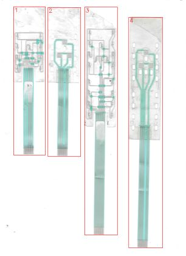

**[Kaynak] P1 önizleme** — `_tarama/parca_1.png`  
12 LED, turkuaz köprü yamaları, kuyrukta beyaz etiket.

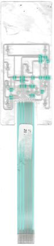

**[Kaynak] Kaynak görüntü** — `_tarama/parca_2.png`  
Taramadan kırpılan / incelenen ham görüntü.

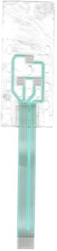

**[Kaynak] Kaynak görüntü** — `_tarama/parca_3.png`  
Taramadan kırpılan / incelenen ham görüntü.

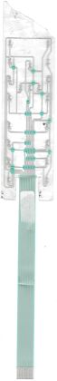

**[Kaynak] Kaynak görüntü** — `_tarama/parca_4.png`  
Taramadan kırpılan / incelenen ham görüntü.

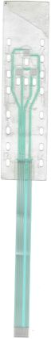

**[Ön işleme] Eğikliği düzeltilmiş görüntü** — `p1_deskew.png`  
0.1° düzeltilmiş tam çözünürlüklü kırpım; tüm px koordinatları bu görüntüye göre. *Ölçüm: Hough sapması 0.108°*

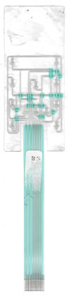

**[Ön işleme] Kontrast güçlendirilmiş** — `enh.png`  
Kaplama damlalarının altını görmek için CLAHE uygulandı.

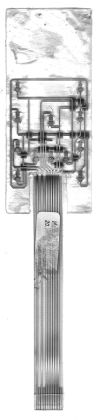

**[Ön işleme] Yüksek geçiren filtre (konnektör toplama bölgesi)** — `fan_hp.png`  
Leke, (L − bulanık L) × 4 ile bastırıldı; altındaki çapraz hatlar görünür hale geldi.

**[Maskeler] İlk segmentasyon (gürültülü)** — `v_seg.png`  
Basit eşik: LED kaplama damlaları ve gölgeler gümüş sayıldı.

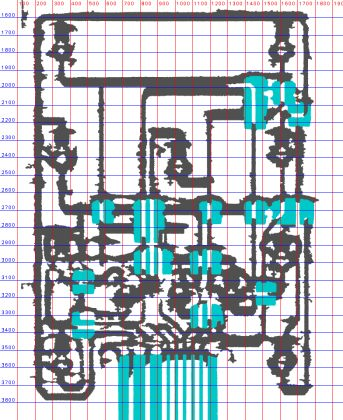

**[Maskeler] Alt gümüş ayrımı** — `v_seg2.png`  
Dielektrik altındaki gümüş koyu turkuaz (R &lt; 82) olarak ayrı renkte; üst gümüş gri.

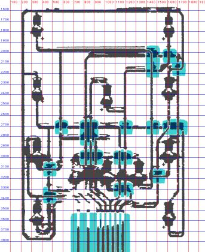

**[Maskeler] Son maskeler: üst gümüş / alt gümüş / dielektrik** — `seg_led.png`  
Doku eşiğiyle gölgeler elendi. Gri = dokulu gümüş, lacivert = dielektrik altı gümüş, açık turkuaz = dielektrik.

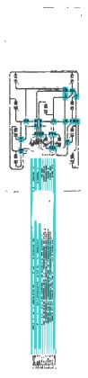

**[Maskeler] Bağlantı bileşenleri (tam ölçek)** — `comp.png`  
Yama içinde yalnızca üst gümüş tutuldu; her renk ayrı iletken bileşen.

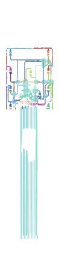

**[Maskeler] Toplama bölgesi uyarlamalı maske** — `fanmask.png`  
Leke altında yerel eşik. Gölge kopyalarını da yakalar: yatay hatların ~20 px üstündeki ikizleri gölgedir.

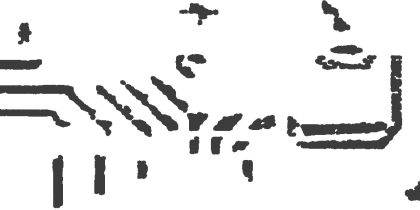

**[Maskeler] Birleşik gümüş poligonları** — `polyvec_vis.png`  
Temizlenmiş maskeden 0/45/90°'ye oturtulmuş poligon konturları; topoloji okumanın en verimli yolu.

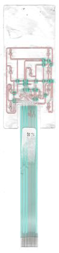

**[Maskeler] Maske / segmentasyon görseli** — `fanmask_full.png`  
Renk ve doku eşikleriyle elde edilen malzeme maskesi.

**[Maskeler] Gölge ofseti (film kalkıklığı) haritası** — `golge_haritasi.png`  
Film camdan kalkık olduğunda her gümüş şeklin koyu kopyası δ kadar yukarı düşer. Karolardaki sayı yerel δ (mm), renk mavi (küçük) → kırmızı (büyük); büyük δ = film daha kalkık, kenarlar daha bulanık. Mor = gölge olarak açıklanan pikseller (doğrulamada karşılıksız gümüş ve kenar örneklerinden çıkarılır).

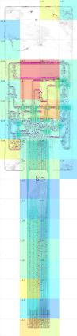

**[Maskeler] Öğrenen sınıflandırıcı sınıf haritası** — `ogren_siniflar.png`  
Onaylı çizimlerden eğitilen rastgele orman: gri film, kırmızı gümüş, lacivert yalıtkan altı gümüş, mavi köprü, turkuaz dielektrik, mor gölge.

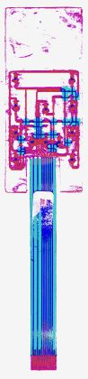

**[Maskeler] Maske / segmentasyon görseli** — `seg.png`  
Renk ve doku eşikleriyle elde edilen malzeme maskesi.

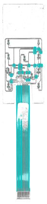

**[Maskeler] Maske / segmentasyon görseli** — `seg3.png`  
Renk ve doku eşikleriyle elde edilen malzeme maskesi.

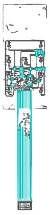

**[Maskeler] Maske / segmentasyon görseli** — `seg_hizli.png`  
Renk ve doku eşikleriyle elde edilen malzeme maskesi.

**[Ölçüm] LED1 yakın çekim** — `z_led1.png`  
0402 LED, iki ped arasındaki boşlukta; yeşil 'T' emitör.

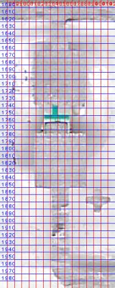

**[Ölçüm] LED1 ped yapısı (kontrast)** — `v_led1e.png`  
Üst ped R1'e bağlı; alt ped boyunla y 1981 hattına iniyor. *Ölçüm: ped 1.65 mm genişlik, boşluk 0.85 mm*

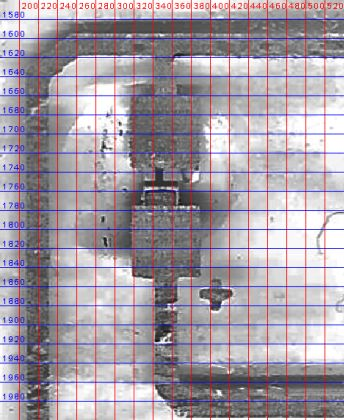

**[Ölçüm] LED1 (orijinal)** — `v_led1.png`  
Kaplama damlası alt pedin kenarlarını genişletmiş gibi gösteriyor.

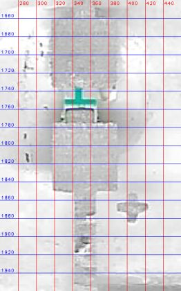

**[Ölçüm] LED C1 (orta üst)** — `v_led2.png`  
Ped şablonunun doğrulandığı ikinci LED.

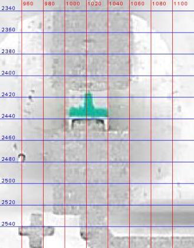

**[Ölçüm] Kart konturu** — `v_outline.png`  
Baş, yarıklar ve kuyruk. *Ölçüm: 36.5 × 87.1 mm, kuyruk 12.0 mm, yarık 2.1 mm*

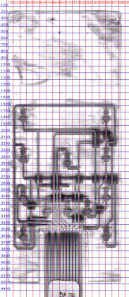

**[Ölçüm] Kuyruk başlangıcı** — `t_tail.png`  
8 hat 1.0 mm adımla; 2. ve 4. pozisyonlar boş. Dielektrik baskı kesime göre asimetrik.

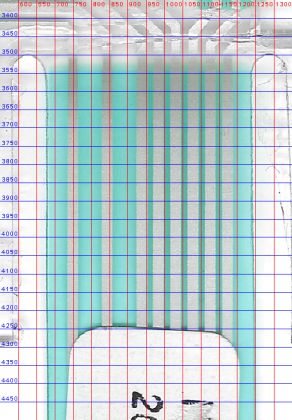

**[Ölçüm] Kuyruk ve etiket** — `t_tail2.png`  
Beyaz yapıştırma etiket (y 4249–5330 px) dielektriği örtüyor; 'Etiket' katmanında yalnızca konturu var.

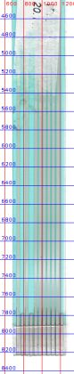

**[Ölçüm] Konnektör ucu** — `t_end.png`  
11 kontak; 2, 4 ve 11 dummy (y 7785 px'ten başlıyor), takviye y 7925 px'ten uca kadar.

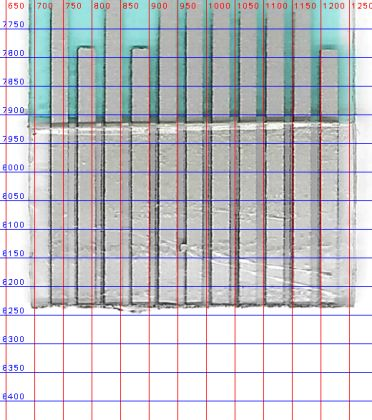

**[Ölçüm] Otomatik hat parçası tespiti** — `segs_vis.png`  
Yatay, dikey ve 45° açılı hat parçaları; ölçüm tablosu olarak kullanıldı, tek başına rota değil.

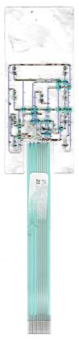

**[Ölçüm] Hat parçaları (üst gümüş)** — `segs_top_vis.png`  
Dokulu maske üzerinde; rotalardaki x/y değerleri bu listeden alındı.

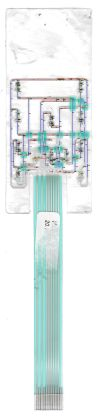

**[Topoloji] Sol yarı (maske)** — `hl_s.png`  
Sol sütun LED'leri, R1 çevre hattı ve iç döngü.

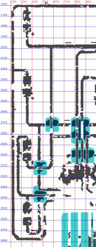

**[Topoloji] Sağ yarı (maske)** — `hr_s.png`  
Sağ sütun LED'leri ve köprü kümeleri.

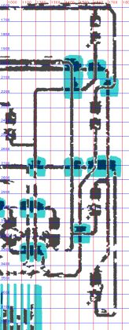

**[Topoloji] Sol yarı (orijinal)** — `hl.png`  
0.5 ölçek, 100 px ızgara.

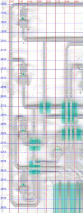

**[Topoloji] Sağ yarı (orijinal)** — `hr.png`  
0.5 ölçek, 100 px ızgara.

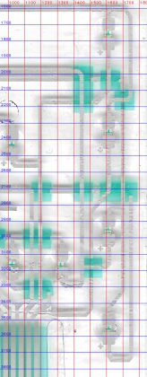

**[Topoloji] Bileşen haritası** — `v_comp.png`  
Yamalar açık turkuaz; altından geçen hatlar yamada kesik görünüyor. Ağlar bu haritadan okundu.

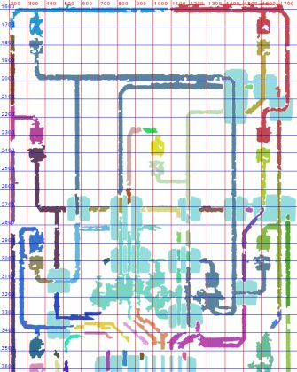

**[Topoloji] Birleşik poligon görünümü** — `v_pv.png`  
Kırmızı konturlar: tüm gümüş. Orta-alt bölgede leke nedeniyle düzensizlik var.

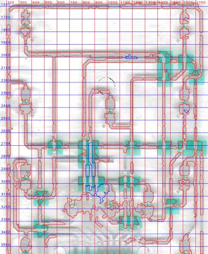

**[Topoloji] Orta-alt leke bölgesi** — `v_ctr.png`  
B1/B2/B3 LED'lerinin bağlantıları leke altında; maske güvenilmez. Bu rotalar Kontrol katmanında.

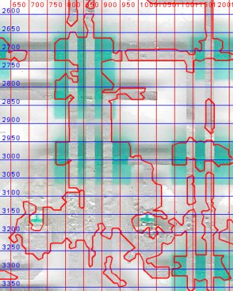

**[Topoloji] Rota bindirmesi** — `routes_view.png`  
Her renk bir rota. Noktalar, gerçek merkez çizgisine oturtulmuş köşeler.

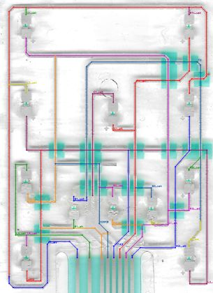

**[Topoloji] Çizimden çıkarılan ağ haritası** — `ag_haritasi.png`  
Çizim geometrisinden çıkarılan elektrik ağları: her ağ ayrı renk, köprüler koyu kontur, altta pin numaraları; kırmızı halka = HATA, turuncu = UYARI, gri = bilinen (kabul edilmiş) bulgu.

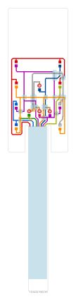

**[Topoloji] Otomatik rota önerisi** — `rota_onerisi.png`  
Aday segment + MILP + graf ile önerilen rotalar: yeşil güvenli, turuncu düşük güven (flag). Elle yazılan rotaların başlangıcıdır.

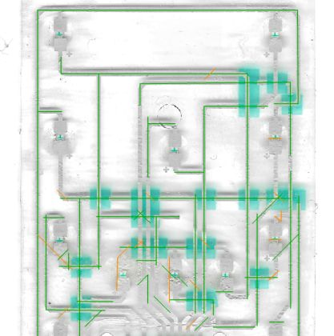

**[Karar kanıtı] Köprü yaması örneği** — `v_x1.png`  
Dikey hatlar açık gri (dielektrik üstünde = köprü); yatay hatlar koyu turkuaz (dielektrik altında).

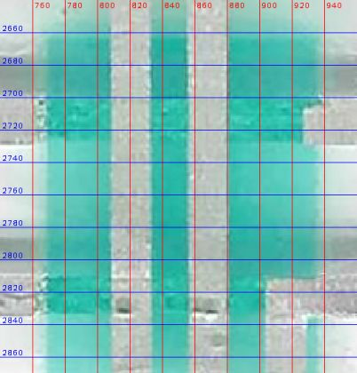

**[Karar kanıtı] Sağ üst köprü kümesi** — `z_x2b.png`  
x 1449 ve 1614'teki dikeyler üstten, y 2030 ve 2173'teki yataylar alttan geçiyor.

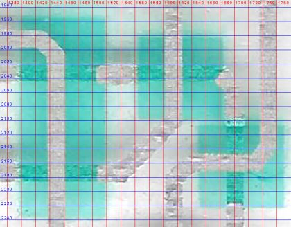

**[Karar kanıtı] R1 köprüsü (y 2158)** — `zx3.png`  
R1 sağ kenardan sola dönüp yamanın üstünden geçiyor; x 1700'deki T3 hattı altından geçiyor.

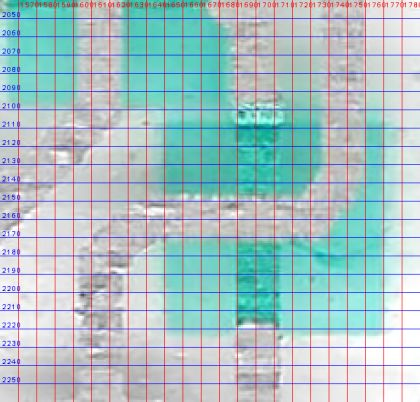

**[Karar kanıtı] R1L katodu: dikeyden 45° çapraza dönüş** — `zx4.png`  
V2 dikeyi y ≈ 2110'da 45° ile sola dönüp y 2173 hattına bağlanıyor. Dikeyin alt kısmı (LED R2 anodu) R1'den besleniyor; bu ayrım bir kısa devre paradoksunu çözdü.

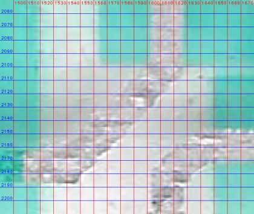

**[Karar kanıtı] Sağ orta yama kümesi (y 2700)** — `zr3.png`  
y 2714 hattı alttan; x 1614, 1700 dikeyleri ve 45° çapraz üstten geçiyor.

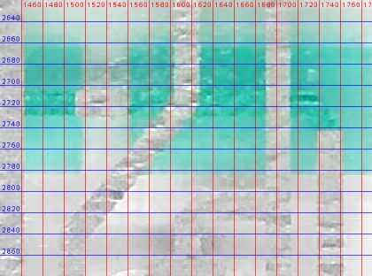

**[Karar kanıtı] Sol alt yama (y 3050–3185)** — `zo_c1.png`  
Tek yama: x 462 dikeyi altından (koyu turkuaz), y 3115 yatayı üstünden geçiyor. Gri bant yamayı ikiye bölmüş gibi görünüyor ama tek yama.

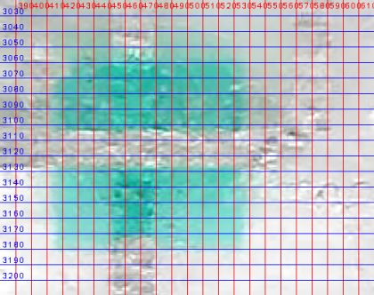

**[Karar kanıtı] Sol alt yama (y 3290–3435)** — `zo_c2.png`  
y 3350 yatayı ve x 462 dikeyi altından, y 3376 yatayı üstünden geçiyor.

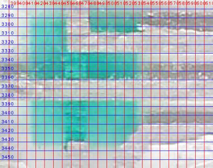

**[Karar kanıtı] V466 üst bağlantısı** — `zj466.png`  
LED2 katot hattı y 2714'ten aşağı dikey olarak devam ediyor (L ≈ 190–200: gümüş).

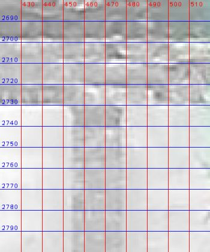

**[Karar kanıtı] V466 dikeyi boyunca** — `z_v462.png`  
Dikey 2714'ten 3728 px'e kadar sürekli; alt ucunda boşluk var.

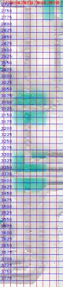

**[Karar kanıtı] Sol alt ve sağ alt (poligon)** — `v_bot.png`  
Poligon görünümünde R1 alt hattı, V466 ve L4 pedi birleşik görünüyor; bunun nedeni gölge. Sayısal profil, V466 ile R1 arasında boşluk olduğunu gösterdi.

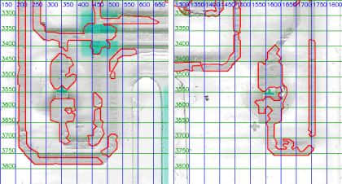

**[Karar kanıtı] R1 sol alt dönüşü** — `z_bl.png`  
R1 x 220'den aşağı iner, y 3776'da sağa döner; ardından pahla x 516 dikeyine bağlanır.

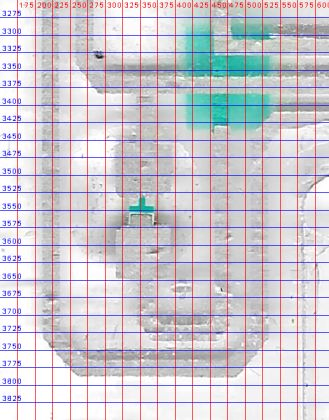

**[Karar kanıtı] Sol alt bölge (maske)** — `zs_bl.png`  
LED3/LED4 iç döngüsü ve R1 alt U'su.

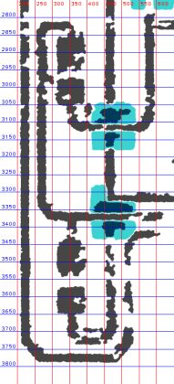

**[Karar kanıtı] LED4 çevresi** — `zled4.png`  
Kaplama damlası ped kenarlarını örtüyor.

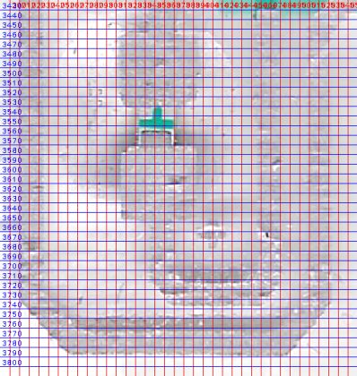

**[Karar kanıtı] Konnektör toplama bölgesi (orijinal)** — `zfan_o.png`  
Yarı saydam leke kontrastı düşürüyor.

**[Karar kanıtı] Toplama bölgesi (yüksek geçiren)** — `zfan_hp2.png`  
Soldan 3 çapraz sağ-aşağı, sağdan 3 çapraz sol-aşağı iniyor; 8 hat 8 pine.

**[Karar kanıtı] Toplama bölgesi (uyarlamalı maske)** — `zfan_m.png`  
45° parçaların konumları; pin eşlemesindeki doğru denklemleri buradan.

**[Karar kanıtı] Başarısız: otomatik iskelet** — `v_skel.png`  
İskelet grafı 736 sahte kenar üretti; yöntem reddedildi.

**[Doğrulama] Baş bölgesi bindirme** — `ov_head.png`  
Turuncu kümeler: yatay hatların üstünde ince şerit = gölge; LED çevresinde = kaplama; orta-alt = leke.

**[Doğrulama] Rapor kontrol kırpımı: bas bolgesi** — `kontrol_bas_bolgesi.png`  
Doğrulama bindirmesinden kırpım. Bindirme renkleri: kırmızı gümüş (alt baskı), mavi köprü (2. baskı), yeşil dielektrik, mor kesim/oval, turuncu taramada olup çizimde karşılığı olmayan gümüş.

**[Doğrulama] Rapor kontrol kırpımı: konnektor toplama** — `kontrol_konnektor_toplama.png`  
Doğrulama bindirmesinden kırpım. Bindirme renkleri: kırmızı gümüş (alt baskı), mavi köprü (2. baskı), yeşil dielektrik, mor kesim/oval, turuncu taramada olup çizimde karşılığı olmayan gümüş.

**[Doğrulama] Rapor kontrol kırpımı: konnektor ucu** — `kontrol_konnektor_ucu.png`  
Doğrulama bindirmesinden kırpım. Bindirme renkleri: kırmızı gümüş (alt baskı), mavi köprü (2. baskı), yeşil dielektrik, mor kesim/oval, turuncu taramada olup çizimde karşılığı olmayan gümüş.

**[Doğrulama] Rapor kontrol kırpımı: kopru kumesi sag ust** — `kontrol_kopru_kumesi_sag_ust.png`  
Doğrulama bindirmesinden kırpım. Bindirme renkleri: kırmızı gümüş (alt baskı), mavi köprü (2. baskı), yeşil dielektrik, mor kesim/oval, turuncu taramada olup çizimde karşılığı olmayan gümüş.

**[Doğrulama] Kenar sapması ısı haritası: bas bolgesi** — `kontrol_sapma_bas_bolgesi.png`  
Çizimin her kenar örneğinde taramadaki malzeme kenarına alt-piksel uzaklık: yeşil ≤ 0.02 mm, sarı ≤ 0.05, turuncu ≤ 0.10, kırmızı > 0.10 mm, mor taramada karşılık bulunamadı (eleman yanlış yerde ya da referans maske orada eksik).

**[Doğrulama] Kenar sapması ısı haritası: konnektor toplama** — `kontrol_sapma_konnektor_toplama.png`  
Çizimin her kenar örneğinde taramadaki malzeme kenarına alt-piksel uzaklık: yeşil ≤ 0.02 mm, sarı ≤ 0.05, turuncu ≤ 0.10, kırmızı > 0.10 mm, mor taramada karşılık bulunamadı (eleman yanlış yerde ya da referans maske orada eksik).

**[Doğrulama] Kenar sapması ısı haritası: konnektor ucu** — `kontrol_sapma_konnektor_ucu.png`  
Çizimin her kenar örneğinde taramadaki malzeme kenarına alt-piksel uzaklık: yeşil ≤ 0.02 mm, sarı ≤ 0.05, turuncu ≤ 0.10, kırmızı > 0.10 mm, mor taramada karşılık bulunamadı (eleman yanlış yerde ya da referans maske orada eksik).

**[Doğrulama] Kenar sapması ısı haritası: kopru kumesi sag ust** — `kontrol_sapma_kopru_kumesi_sag_ust.png`  
Çizimin her kenar örneğinde taramadaki malzeme kenarına alt-piksel uzaklık: yeşil ≤ 0.02 mm, sarı ≤ 0.05, turuncu ≤ 0.10, kırmızı > 0.10 mm, mor taramada karşılık bulunamadı (eleman yanlış yerde ya da referans maske orada eksik).

**[Doğrulama] Kenar sapması ısı haritası: tamamı** — `ov_sapma.png`  
Çizimin her kenar örneğinde taramadaki malzeme kenarına alt-piksel uzaklık: yeşil ≤ 0.02 mm, sarı ≤ 0.05, turuncu ≤ 0.10, kırmızı > 0.10 mm, mor taramada karşılık bulunamadı (eleman yanlış yerde ya da referans maske orada eksik).

**[Doğrulama] Taramaya bindirme** — `overlay.png`  
Çizim geometrisi taramanın üstüne çizildi. Bindirme renkleri: kırmızı gümüş (alt baskı), mavi köprü (2. baskı), yeşil dielektrik, mor kesim/oval, turuncu taramada olup çizimde karşılığı olmayan gümüş.

**[Çıktı kontrolü] Düzenlenebilir SVG önizlemesi** — `r_edit2.png`  
Mor kesikli çizgiler = Kontrol katmanı (yorumlanan rotalar).

**[Çıktı kontrolü] Çıktı render kontrolü** — `r_edit.png`  
Üretilen SVG/PDF dosyasının rasterleştirilmiş önizlemesi.

**[Çalışma görüntüleri] Izgaralı yakın çekim** — `Z1.png`  
Ölçüm ve okuma için üretilmiş ızgaralı kırpım (ızgara etiketleri tarama pikseli).

**[Çalışma görüntüleri] Izgaralı yakın çekim** — `Z10.png`  
Ölçüm ve okuma için üretilmiş ızgaralı kırpım (ızgara etiketleri tarama pikseli).

**[Çalışma görüntüleri] Izgaralı yakın çekim** — `Z11.png`  
Ölçüm ve okuma için üretilmiş ızgaralı kırpım (ızgara etiketleri tarama pikseli).

**[Çalışma görüntüleri] Izgaralı yakın çekim** — `Z12.png`  
Ölçüm ve okuma için üretilmiş ızgaralı kırpım (ızgara etiketleri tarama pikseli).

**[Çalışma görüntüleri] Izgaralı yakın çekim** — `Z13.png`  
Ölçüm ve okuma için üretilmiş ızgaralı kırpım (ızgara etiketleri tarama pikseli).

**[Çalışma görüntüleri] Izgaralı yakın çekim** — `Z14.png`  
Ölçüm ve okuma için üretilmiş ızgaralı kırpım (ızgara etiketleri tarama pikseli).

**[Çalışma görüntüleri] Izgaralı yakın çekim** — `Z15.png`  
Ölçüm ve okuma için üretilmiş ızgaralı kırpım (ızgara etiketleri tarama pikseli).

**[Çalışma görüntüleri] Izgaralı yakın çekim** — `Z16.png`  
Ölçüm ve okuma için üretilmiş ızgaralı kırpım (ızgara etiketleri tarama pikseli).

**[Çalışma görüntüleri] Izgaralı yakın çekim** — `Z2.png`  
Ölçüm ve okuma için üretilmiş ızgaralı kırpım (ızgara etiketleri tarama pikseli).

**[Çalışma görüntüleri] Izgaralı yakın çekim** — `Z3.png`  
Ölçüm ve okuma için üretilmiş ızgaralı kırpım (ızgara etiketleri tarama pikseli).

**[Çalışma görüntüleri] Izgaralı yakın çekim** — `Z4.png`  
Ölçüm ve okuma için üretilmiş ızgaralı kırpım (ızgara etiketleri tarama pikseli).

**[Çalışma görüntüleri] Izgaralı yakın çekim** — `Z5.png`  
Ölçüm ve okuma için üretilmiş ızgaralı kırpım (ızgara etiketleri tarama pikseli).

**[Çalışma görüntüleri] Izgaralı yakın çekim** — `Z6.png`  
Ölçüm ve okuma için üretilmiş ızgaralı kırpım (ızgara etiketleri tarama pikseli).

**[Çalışma görüntüleri] Izgaralı yakın çekim** — `Z7.png`  
Ölçüm ve okuma için üretilmiş ızgaralı kırpım (ızgara etiketleri tarama pikseli).

**[Çalışma görüntüleri] Izgaralı yakın çekim** — `Z8.png`  
Ölçüm ve okuma için üretilmiş ızgaralı kırpım (ızgara etiketleri tarama pikseli).

**[Çalışma görüntüleri] Izgaralı yakın çekim** — `Z9.png`  
Ölçüm ve okuma için üretilmiş ızgaralı kırpım (ızgara etiketleri tarama pikseli).

**[Çalışma görüntüleri] Izgaralı yakın çekim** — `o1.png`  
Ölçüm ve okuma için üretilmiş ızgaralı kırpım (ızgara etiketleri tarama pikseli).

**[Çalışma görüntüleri] Izgaralı yakın çekim** — `o2.png`  
Ölçüm ve okuma için üretilmiş ızgaralı kırpım (ızgara etiketleri tarama pikseli).

**[Çalışma görüntüleri] Izgaralı yakın çekim** — `o3.png`  
Ölçüm ve okuma için üretilmiş ızgaralı kırpım (ızgara etiketleri tarama pikseli).

**[Çalışma görüntüleri] Izgaralı yakın çekim** — `o4.png`  
Ölçüm ve okuma için üretilmiş ızgaralı kırpım (ızgara etiketleri tarama pikseli).

**[Çalışma görüntüleri] Izgaralı yakın çekim** — `q1.png`  
Ölçüm ve okuma için üretilmiş ızgaralı kırpım (ızgara etiketleri tarama pikseli).

**[Çalışma görüntüleri] Izgaralı yakın çekim** — `q2.png`  
Ölçüm ve okuma için üretilmiş ızgaralı kırpım (ızgara etiketleri tarama pikseli).

**[Çalışma görüntüleri] Izgaralı yakın çekim** — `q3.png`  
Ölçüm ve okuma için üretilmiş ızgaralı kırpım (ızgara etiketleri tarama pikseli).

**[Çalışma görüntüleri] Izgaralı yakın çekim** — `q4.png`  
Ölçüm ve okuma için üretilmiş ızgaralı kırpım (ızgara etiketleri tarama pikseli).

**[Çalışma görüntüleri] Izgaralı yakın çekim** — `s11.png`  
Ölçüm ve okuma için üretilmiş ızgaralı kırpım (ızgara etiketleri tarama pikseli).

**[Çalışma görüntüleri] Izgaralı yakın çekim** — `s12.png`  
Ölçüm ve okuma için üretilmiş ızgaralı kırpım (ızgara etiketleri tarama pikseli).

**[Çalışma görüntüleri] Izgaralı yakın çekim** — `s13.png`  
Ölçüm ve okuma için üretilmiş ızgaralı kırpım (ızgara etiketleri tarama pikseli).

**[Çalışma görüntüleri] Izgaralı yakın çekim** — `s21.png`  
Ölçüm ve okuma için üretilmiş ızgaralı kırpım (ızgara etiketleri tarama pikseli).

**[Çalışma görüntüleri] Izgaralı yakın çekim** — `s22.png`  
Ölçüm ve okuma için üretilmiş ızgaralı kırpım (ızgara etiketleri tarama pikseli).

**[Çalışma görüntüleri] Izgaralı yakın çekim** — `s23.png`  
Ölçüm ve okuma için üretilmiş ızgaralı kırpım (ızgara etiketleri tarama pikseli).

**[Çalışma görüntüleri] Izgaralı yakın çekim** — `s31.png`  
Ölçüm ve okuma için üretilmiş ızgaralı kırpım (ızgara etiketleri tarama pikseli).

**[Çalışma görüntüleri] Izgaralı yakın çekim** — `s32.png`  
Ölçüm ve okuma için üretilmiş ızgaralı kırpım (ızgara etiketleri tarama pikseli).

**[Çalışma görüntüleri] Izgaralı yakın çekim** — `s33.png`  
Ölçüm ve okuma için üretilmiş ızgaralı kırpım (ızgara etiketleri tarama pikseli).

**[Çalışma görüntüleri] Izgaralı yakın çekim** — `skel_vis.png`  
Ölçüm ve okuma için üretilmiş ızgaralı kırpım (ızgara etiketleri tarama pikseli).

**[Çalışma görüntüleri] Izgaralı yakın çekim** — `t11.png`  
Ölçüm ve okuma için üretilmiş ızgaralı kırpım (ızgara etiketleri tarama pikseli).

**[Çalışma görüntüleri] Izgaralı yakın çekim** — `t12.png`  
Ölçüm ve okuma için üretilmiş ızgaralı kırpım (ızgara etiketleri tarama pikseli).

**[Çalışma görüntüleri] Izgaralı yakın çekim** — `t13.png`  
Ölçüm ve okuma için üretilmiş ızgaralı kırpım (ızgara etiketleri tarama pikseli).

**[Çalışma görüntüleri] Izgaralı yakın çekim** — `t21.png`  
Ölçüm ve okuma için üretilmiş ızgaralı kırpım (ızgara etiketleri tarama pikseli).

**[Çalışma görüntüleri] Izgaralı yakın çekim** — `t22.png`  
Ölçüm ve okuma için üretilmiş ızgaralı kırpım (ızgara etiketleri tarama pikseli).

**[Çalışma görüntüleri] Izgaralı yakın çekim** — `t23.png`  
Ölçüm ve okuma için üretilmiş ızgaralı kırpım (ızgara etiketleri tarama pikseli).

**[Çalışma görüntüleri] Izgaralı yakın çekim** — `t31.png`  
Ölçüm ve okuma için üretilmiş ızgaralı kırpım (ızgara etiketleri tarama pikseli).

**[Çalışma görüntüleri] Izgaralı yakın çekim** — `t32.png`  
Ölçüm ve okuma için üretilmiş ızgaralı kırpım (ızgara etiketleri tarama pikseli).

**[Çalışma görüntüleri] Izgaralı yakın çekim** — `t33.png`  
Ölçüm ve okuma için üretilmiş ızgaralı kırpım (ızgara etiketleri tarama pikseli).

**[Çalışma görüntüleri] Izgaralı yakın çekim** — `v_all.png`  
Ölçüm ve okuma için üretilmiş ızgaralı kırpım (ızgara etiketleri tarama pikseli).

**[Çalışma görüntüleri] Izgaralı yakın çekim** — `v_head.png`  
Ölçüm ve okuma için üretilmiş ızgaralı kırpım (ızgara etiketleri tarama pikseli).

**[Çalışma görüntüleri] Izgaralı yakın çekim** — `z_t452.png`  
Ölçüm ve okuma için üretilmiş ızgaralı kırpım (ızgara etiketleri tarama pikseli).

**[Çalışma görüntüleri] Izgaralı yakın çekim** — `z_x2.png`  
Ölçüm ve okuma için üretilmiş ızgaralı kırpım (ızgara etiketleri tarama pikseli).

**[Çalışma görüntüleri] Izgaralı yakın çekim** — `zfan.png`  
Ölçüm ve okuma için üretilmiş ızgaralı kırpım (ızgara etiketleri tarama pikseli).

**[Çalışma görüntüleri] Izgaralı yakın çekim** — `zfan_hp.png`  
Ölçüm ve okuma için üretilmiş ızgaralı kırpım (ızgara etiketleri tarama pikseli).

## Çıktılar

- `output/P1_duzenlenebilir.svg` — CorelDRAW'da düzenleme (hatlar kalınlıklı çizgi, pedler dikdörtgen)
- `output/P1_uretim.svg` — Üretim: her katman tek kapalı dolgu
- `output/P1_uretim.pdf` — Üretim: katmanlı vektör PDF
- `output/P1_kontrol_taramali.svg` — Kontrol: çizim + altta hizalı tarama