# P2 - Kısa tuş devresi (3 tuş, 11 pin 1.0 mm)

*13.11.2026 17:40 — fpc-vektor skill · etkileşimli sürüm: `P2_rapor.html`*

**Kabul:** GEÇTİ · **Belirsiz rota:** 0 · **Kontrol maddesi:** 3 · **Karar noktası:** 10

## Özet

3 tuşlu membran anahtar katmanı (tarak tipi pedler), 12 oval LED ışık penceresi, 11 pinlik 1.0 mm ZIF kuyruğu. Tek gümüş baskı + dielektrik şerit/çerçeve. P1 LED devresiyle üst üste biner.

## Analiz süreci

1. **Kaynağın incelenmesi** — K.pdf metin içermeyen tek sayfalık bir tarama: 10192×14016 px JPEG, 1199 dpi (47.21 px/mm). Sayfada 4 FPC parçası bulundu; P2 ikinci parça.
2. **Kırpım ve eğiklik düzeltmesi** — Parça tam çözünürlükte kırpıldı. Hough doğrularıyla hatların eksenden sapması baş bölgesinde 0.73°, kuyrukta 0.80° ölçüldü; 0.76° ile düzeltildi. Sonrasında kuyruk hatları 1800 px boyunca 1 px'ten az kayıyor.
3. **Renk segmentasyonu** — Gümüş (açık gri, düşük doygunluk), dielektrik (G−R &gt; 30) ve film ayrıldı. Global eşik denemesi film gölgelerini de gümüş saydığı için yerel arka plana göre eşiklemeye geçildi.
4. **Ölçek kalibrasyonu** — Kuyruktaki 9 hattın merkezleri T kanalı kenarlarından alt-piksel ölçüldü. Adım 47.17 px çıktı; 1.00 mm kabul edildi. Tarayıcı nominaliyle fark %0.08.
5. **Kesim konturu** — Baş kenarları, köşeler, yarıklar ve kuyruk ucu profillerle ölçüldü. Üst kenarlarda gölge bandı kenarın üstünde kaldığı için gerçek kenar bandın alt ucu alındı.
6. **Hatlar ve dielektrik şeritler** — Şerit içi gümüş maskesinin iskeletinden hat merkez çizgileri çıkarıldı. Doğrular SVD ile yeniden oturtuldu, köşeler kesişimlerden hesaplandı. Hat 0.50 mm, üstündeki dielektrik şerit 2.0 mm.
7. **Tarak pedleri** — Her ped için parmak ve boşluk sütunlarında ayrı dikey profiller alındı. Ped 5.0×5.0 mm; parmak 0.6, boşluk 0.5, bar 0.55 mm. A pedinde üst tarakta dış 3 parmak, B ve C'de iç 2 parmak var.
8. **Kuyruk bağlantı blokları ve konnektör** — Baştan gelen 4 ağ 2-2-2-3 kontağa bölünüyor; 7. ve 8. pozisyonlar yalnızca uçta dummy kontak. Kontak bölgesi 8 mm ve dielektriksiz, arkasında takviye var.
9. **Oval pencereler** — 12 ovalin kenar gölge piksellerine robust stadium fit uygulandı. Genişlik tutarlı 3.20 mm; boylar uçlardaki gölge yüzünden 5.8–6.3 mm arasında. Hepsi 6.1 mm alındı.
10. **Üretim ve doğrulama** — Parametrik tasarımdan 4 dosya üretildi ve taramaya bindirildi. Dielektrik IoU 0.968; kenar sapmaları eşiklerin altında.

## Bulgular

- Yapı: tek gümüş baskı + dielektrik (hat üstünde 2.0 mm şerit, ped çevresinde 0.2 mm çerçeve, kuyrukta tam kaplama) + arka takviye.
- 4 elektriksel ağ: Net1 = A üst tarak; Net2 = B alt tarak; Net3 = C alt tarak; Net4 (ortak) = A alt + B ve C üst tarakları. Sinyal ağları 2'şer, ortak ağ 3 pine bağlanıyor.
- Tuş grubu ve orta ovaller kart eksenine göre 0.85 mm sağda (x = 19.2 mm). Bu kayma taramada tutarlı, tasarımın parçası kabul edildi.
- Çapraz hatlar 45° değil: sol üst 60.0°, sol alt 51.4°, sağ alt 50.2°. Açılar ölçüldüğü gibi korundu.
- Kesim deseni baskıya göre ~0.2° dönük ve ~0.1 mm kayık; bu bir üretim toleransı.
- Ovaller, P1'deki 12 LED ile x'te 0.1 mm içinde örtüşüyor; iki parça birbirini doğruluyor.

## Karar noktaları

### K1. Pilot parça ve çıktı kapsamı

- Seçenek: 4 parçanın hepsi
- Seçenek: Kısa set
- Seçenek: Uzun set
- Seçenek: Tek parça ile pilot
- **Seçilen:** Tek parça ile pilot (P2). Amaç hem üretim hem dokümantasyon; SVG + PDF; katmanlar kontur, gümüş, dielektrik ve LED.
- Gerekçe: Kalite önce en az elemanlı parçada onaylatıldı.

### K2. Ölçek kaynağı

- Seçenek: Tarayıcı nominali 47.207 px/mm
- Seçenek: Konnektör adımı (1.00 mm) kalibrasyonu 47.17 px/mm
- **Seçilen:** Konnektör adımı: 47.17 px/mm
- Gerekçe: Konnektör adımı standart 1.00 mm; karşı konnektörle uyum için en kritik ölçü bu. Fark yalnızca %0.08.
- Kanıt: [v_ct.png](P2_rapor_gorseller/v_ct.jpg), [v_end.png](P2_rapor_gorseller/v_end.jpg)

### K3. Ped barlarının üstündeki koyu bantlar

- Seçenek: Koyu bant barın parçası (bar 0.95 mm)
- Seçenek: Koyu bant tarayıcı gölgesi (bar 0.55 mm)
- **Seçilen:** Gölge: bar 0.55 mm
- Gerekçe: Bant her yatay gümüş kenarın ~20 px üstünde ve aynı biçimde çıkıyor; dokusuz. Gölge kabul edilince parmak uç boşluğu yan boşlukla eşitleniyor (0.5 mm) ve ped tam 5.0 mm oluyor.
- Risk: Bantlar gerçekse bar 0.4 mm kalın çizilmiş olur; elektriksel etkisi yok.
- Kanıt: [v_padA2.png](P2_rapor_gorseller/v_padA2.jpg), [v_pAb.png](P2_rapor_gorseller/v_pAb.jpg), [v_pB.png](P2_rapor_gorseller/v_pB.jpg)

### K4. Kesim deseninin dönüklüğü

- Seçenek: Ölçüldüğü gibi (0.2° dönük)
- Seçenek: İdeal: baskıya hizalı ve simetrik
- **Seçilen:** İdeal hizalı ve simetrik
- Gerekçe: Dönüklük, baskı ile kesim arasındaki üretim toleransı; tasarım niyeti simetri.
- Kanıt: [v_tl.png](P2_rapor_gorseller/v_tl.jpg), [v_tr.png](P2_rapor_gorseller/v_tr.jpg), [ov_corners.png](P2_rapor_gorseller/ov_corners.jpg)

### K5. Kuyruk dielektriğinin kontur dışına taşması

- Seçenek: Baskı taşmasıyla (bleed) bırak
- Seçenek: Kart konturuyla kırp
- **Seçilen:** Kart konturuyla kırpıldı
- Gerekçe: Taramada dielektrik kesim kenarına kadar uzanıyor; kontur dışında film yok. Temiz görünüm.
- Kanıt: [pdf_head.png](P2_rapor_gorseller/pdf_head.jpg)

### K6. Oval boyları

- Seçenek: Her oval kendi ölçülen boyunda
- Seçenek: Hepsi 3.2 × 6.1 mm
- **Seçilen:** Hepsi 3.2 × 6.1 mm
- Gerekçe: Genişlikler 3.20 mm'de tutarlı; boy farkları uçlardaki gölgeden kaynaklanan fit gürültüsü.
- Kanıt: [v_edge.png](P2_rapor_gorseller/v_edge.jpg), [edge.png](P2_rapor_gorseller/edge.jpg)

### K7. Köşe yarıçapı

- Seçenek: Ölçülen 0.5–1.0 mm (köşe bazında)
- Seçenek: Tümü R1.0
- **Seçilen:** R1.0 (fiziksel kontrol maddesi)
- Kanıt: [corners.png](P2_rapor_gorseller/corners.jpg), [v_tl.png](P2_rapor_gorseller/v_tl.jpg), [v_tr.png](P2_rapor_gorseller/v_tr.jpg)

### K8. Ped çevresindeki ince turkuaz çerçeve

- Seçenek: Dielektrik baskı
- Seçenek: Spacer veya yapışkan kenarı (çizilmez)
- **Seçilen:** Dielektrik baskı (fiziksel kontrol maddesi)
- Gerekçe: Ped kenarından 0.75 mm ofsetli; hat şeritlerinin bindirmesiyle aynı mantık.
- Kanıt: [v_padA2.png](P2_rapor_gorseller/v_padA2.jpg), [v_s4.png](P2_rapor_gorseller/v_s4.jpg)

### K9. Çapraz hat açıları

- Seçenek: 45°'ye oturt
- Seçenek: Ölçüldüğü gibi bırak (60.0 / 51.4 / 50.2°)
- **Seçilen:** Ölçüldüğü gibi
- Gerekçe: Fit hatası 0.3°'nin altında; 45°'ye zorlamak 0.3–0.5 mm kaymaya yol açar.
- Kanıt: [v_h2.png](P2_rapor_gorseller/v_h2.jpg), [bends.png](P2_rapor_gorseller/bends.jpg)

### K10. Saydamlık uygulaması

- Seçenek: Grup saydamlığı
- Seçenek: Nesne bazında saydamlık
- **Seçilen:** Nesne bazında
- Gerekçe: CorelDRAW SVG içe aktarırken grup saydamlığını kaybedebiliyor.

## Ölçüler

| Ölçü | Değer | Not |
|---|---|---|
| Baş (genişlik × yükseklik) | 36.7 × 87.4 mm | köşe R1.0 |
| Toplam boy | 171.9 mm |  |
| Kuyruk genişliği | 12.1 mm | yarık 2.0 mm, üst ucu y=71.55 |
| Konnektör | 11 poz × 1.0 mm | kontak 0.6 mm, 7-8 dummy |
| Hat genişliği (baş) | 0.5 mm | dielektrik şerit 2.0 mm |
| Tuş pedi | 5.0 × 5.0 mm | bar 0.55, parmak 0.6, boşluk 0.5, uç boşluğu 0.5 mm |
| Oval pencere | 3.2 × 6.1 mm | 12 adet |
| Dielektrik bitişi / takviye | y=163.9 / y=164.0 mm |  |
| Kart sınır kutusu | 36.70 × 171.90 mm | Kesim konturu |
| Kart alanı | 4166.6 mm² |  |
| Gümüş alanı (alt baskı) | 669.0 mm² |  |
| Dielektrik alanı | 1363.7 mm² |  |

| Eleman | Adet |
|---|---|
| Hat (polyline) | 16 |
| Gümüş dikdörtgen (ped/blok/parmak) | 25 |
| Oval pencere | 12 |
| LED | 0 |
| Dielektrik yama | 0 |
| Köprü | 0 |
| Kontrol (belirsiz) rota | 0 |

### Varsayımlar

- Ölçek konnektör adımı 1.00 mm alınarak kalibre edildi (47.17 px/mm; tarayıcı nominali 47.21).
- Kesim deseni baskıya göre ~0.2° dönük ölçüldü; çizimde ideal hizalı ve simetrik alındı.
- Baş köşe yarıçapı R1.0 mm (taramada 0.5–1.0 mm).
- Tüm ovaller 3.2 × 6.1 mm (ölçülen boylar 5.8–6.3 mm).
- Ped çevresindeki ince turkuaz çerçeve dielektrik baskı kabul edildi.
- Yatay gümüş kenarların ~0.4 mm üstündeki koyu bantlar tarayıcı gölgesi sayıldı, çizilmedi.

## Doğrulama

| Metrik | Değer | Eşik | Sonuç |
|---|---|---|---|
| Gümüş kenar sapması medyan | 0.021 mm | ≤ 0.06 mm | ✔ |
| Gümüş kenar sapması %90 | 0.067 mm | ≤ 0.15 mm | ✔ |
| Gümüş kenar kapsaması | 0.963 | ≥ 0.8 | ✔ |
| Dielektrik IoU | 0.968 | ≥ 0.95 | ✔ |
| Dielektrik kenar sapması medyan | 0.032 mm | ≤ 0.06 mm | ✔ |
| Dielektrik kenar sapması %90 | 0.118 mm | ≤ 0.15 mm | ✔ |
| Ağ / tutarlılık HATA (bilinmeyen) | 0 | ≤ 0 | ✔ |
| Gümüş sistematik ofset (her yan) / kayma | -0.009 mm / (+0.013, +0.020) mm | |ofset| uyarı > 0.03 | — |
| Gümüş işaretli sapma medyanı | -0.007 mm | + geniş / − dar | — |
| Gümüş yoğunluk kenarı (maskeden bağımsız) medyan / %90 | 0.020 / 0.064 mm | kapsama 0.99; ±6 px dışı sapma ölçülmez (kapı değil) | — |
| Gümüş yoğunluk ofseti / kayma / bulanıklık σ | -0.007 mm / (+0.014, +0.012) mm / 0.032 mm | maske ofsetiyle farkı = maske yanlılığı | — |
| Gümüş: tarama kenarlarının çizime ≤ 3 px oranı | 0.724 | bilgi (ters yön) | — |
| Gümüş IoU | 0.812 | bilgi | — |
| Taramada karşılıksız gümüş (ham / gölge hariç) | 0.076 / 0.074 | uyarı > 0.15 | — |
| Dielektrik sistematik ofset (her yan) / kayma | -0.015 mm / (-0.012, -0.063) mm | |ofset| uyarı > 0.03 | — |
| Dielektrik işaretli sapma medyanı | -0.013 mm | + geniş / − dar | — |
| Dielektrik yoğunluk kenarı (maskeden bağımsız) medyan / %90 | 0.032 / 0.081 mm | kapsama 0.96; ±6 px dışı sapma ölçülmez (kapı değil) | — |
| Dielektrik yoğunluk ofseti / kayma / bulanıklık σ | -0.004 mm / (+0.000, -0.046) mm / 0.033 mm | maske ofsetiyle farkı = maske yanlılığı | — |
| Dielektrik: tarama kenarlarının çizime ≤ 3 px oranı | 0.707 | bilgi (ters yön) | — |
| Dielektrik IoU | 0.968 | kapıda | — |
| Gölge ofseti δ (genel) / kalkık karo | 0.32 mm / 0 | golge_haritasi.png | — |
| Gümüş kenar (eski tam-piksel yöntem) medyan / %90 | 0.021 / 0.064 mm | önceki sürümle kıyas | — |
| Dielektrik kenar (eski tam-piksel yöntem) medyan / %90 | 0.042 / 0.127 mm | önceki sürümle kıyas | — |

### En büyük sapmalı elemanlar

| Eleman | Tür | Medyan mm | Ofset mm | Kayma mm | Kapsama | Örnek |
|---|---|---|---|---|---|---|
| Blok_Net1 | dikdortgen | nan | +0.000 | (+0.000, +0.000) | 0.00 | 52 |
| Blok_Net3 | dikdortgen | nan | +0.000 | (+0.000, +0.000) | 0.00 | 52 |
| Blok_Net4 | dikdortgen | 0.128 | +0.096 | (+0.052, +0.000) | 0.21 | 71 |
| Blok_Net2 | dikdortgen | 0.126 | +0.000 | (+0.000, +0.000) | 0.02 | 52 |
| Ped_B | tus_ped | 0.051 | +0.069 | (-0.003, -0.051) | 0.50 | 857 |
| Kontak_08_dummy | kontak | 0.046 | -0.039 | (+0.014, +0.006) | 1.00 | 163 |
| Kontak_07_dummy | kontak | 0.037 | -0.036 | (+0.021, +0.005) | 1.00 | 163 |
| Ped_C | tus_ped | 0.032 | +0.005 | (+0.028, +0.018) | 0.61 | 773 |
| Ped_A | tus_ped | 0.029 | +0.032 | (-0.016, -0.051) | 0.67 | 845 |
| Kontak_03 | kontak | 0.028 | -0.012 | (+0.027, +0.000) | 1.00 | 2881 |
| Hat_Net4_Bus_BC | hat | 0.027 | -0.006 | (+0.000, +0.006) | 0.76 | 316 |
| Kontak_02 | kontak | 0.025 | -0.004 | (+0.011, +0.000) | 1.00 | 2881 |

## Ağ ve tasarım tutarlılığı

HATA 0 · UYARI 0 · bilgi 10 · kabul edilmiş 0

### Çizimden çıkarılan ağlar

| Ağ | Pinler | Uçlar | Hat |
|---|---|---|---|
| 1 | 1, 2 | Ped_A.ust | 3 |
| 2 | 3, 4 | Ped_B.alt | 3 |
| 3 | 5, 6 | Ped_C.alt | 3 |
| 4 | 9, 10, 11 | Ped_A.alt, Ped_B.ust, Ped_C.ust | 6 |
| 5 | dummy 7 | — | 0 |
| 6 | dummy 8 | — | 0 |

## Önerilen düzeltmeler (ölçümden)

- **diel_kayma:** Dielektrik, telafiden sonra hâlâ (+0.000, -0.046) mm kayık: SCAN['diel_kayma_mm'] [0.0, 0.0] -> [-0.0, 0.046] (çizim ideal kalır, yalnız doğrulama telafisi).
- **eleman:** 'Blok_Net1' (dikdortgen) taramaya göre (+0.088, +0.010) mm kaymış -> (-0.088, -0.010) mm taşı
- **eleman:** 'Blok_Net3' (dikdortgen) taramaya göre (+0.086, +0.013) mm kaymış -> (-0.086, -0.013) mm taşı
- **eleman:** 'Blok_Net2' (dikdortgen) taramaya göre (+0.085, -0.005) mm kaymış -> (-0.085, +0.005) mm taşı
- **eleman:** 'Hat_Net3_C_alt' (hat) taramaya göre (+0.062, -0.078) mm kaymış -> (-0.062, +0.078) mm taşı
- **eleman:** 'Blok_Net4' (dikdortgen) taramaya göre (+0.070, +0.026) mm kaymış -> (-0.070, -0.026) mm taşı
- **eleman:** 'Ped_B' (tus_ped) taramaya göre (-0.008, +0.052) mm kaymış -> (+0.008, -0.052) mm taşı

## Pin eşlemesi

| Pin | Bağlantı |
|---|---|
| 1-2 | Net1: A üst tarak (sol dış hat) |
| 3-4 | Net2: B alt tarak |
| 5-6 | Net3: C alt tarak |
| 7-8 | dummy |
| 9-11 | Net4 ortak: A alt + B/C üst tarak |

## Fiziksel kontrol

- [ ] Köşe yarıçapı (R1.0 mm varsayıldı)
- [ ] Ped çerçevesi: dielektrik mi, spacer/yapışkan kenarı mı?
- [ ] Kuyruk ucundaki 7.9 mm bölge arka yüz takviyesi mi?

## Daha iyi sonuç için

- **Kumpasla 3 ölçü verin:** Baş genişliği, toplam boy ve bir ovalin boyu. Bu üç değer ölçek ve köşe varsayımlarını kesinleştirir; tasarım dosyasında tek satırla güncellenir.
- **Ped çerçevesini doğrulayın:** Ped çevresindeki ince turkuaz çizgi dielektrik baskı mı, yoksa spacer/yapışkan kenarı mı? Spacer ise çizimden çıkarılıp ayrı bir katman yapılır.
- **Takviyeyi doğrulayın:** Konnektör ucundaki ~7.9 mm bölgenin arkasında takviye (stiffener) var mı, kalınlığı ne kadar? ZIF konnektör modeli biliniyorsa bildirin; kontak uzunluğu ona göre ayarlanır.
- **Daha iyi tarama için:** Filmi camda tamamen düz bastırın (üstüne cam veya düz siyah karton koyun), 1200–2400 dpi tarayın. Mümkünse ışık masası üstünde arkadan aydınlatın: gümüş siyah görünür, gölge ve yansıma sorunları ortadan kalkar.
- **CorelDRAW geri bildirimi:** Dosyayı açtığınızda katmanların grup olarak gelip gelmediğini ve renk/saydamlıkların doğru görünüp görünmediğini bildirin; yazıcı ayarı buna göre düzeltilir.

## Analiz görselleri

**[Kaynak] Taramanın genel görünümü ve tespit edilen parçalar** — `_tarama/genel.png`  
K.pdf ~60 dpi önizleme. Numaralı kutular: 1 = P1 (kısa LED), 2 = P2 (kısa tuş), 3 = P3 (uzun LED), 4 = P4 (uzun tuş).

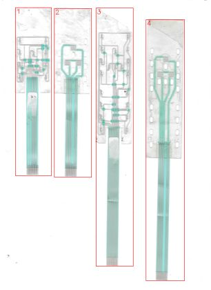

**[Kaynak] P2 önizleme** — `_tarama/parca_2.png`  
Parçanın ~150 dpi önizlemesi: baş bölgesinde 3 tarak ped ve oval pencereler, altta kuyruk.

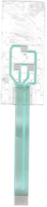

**[Kaynak] Ham kırpım (eğik)** — `p2_full.png`  
Tam çözünürlüklü kırpım; hatlar 0.76° eğik. *Ölçüm: Hough sapması baş 0.731°, kuyruk 0.797°*

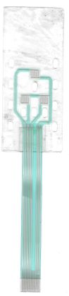

**[Kaynak] Kaynak görüntü** — `_tarama/parca_1.png`  
Taramadan kırpılan / incelenen ham görüntü.

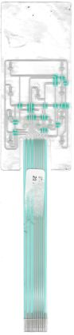

**[Kaynak] Kaynak görüntü** — `_tarama/parca_3.png`  
Taramadan kırpılan / incelenen ham görüntü.

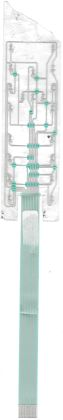

**[Kaynak] Kaynak görüntü** — `_tarama/parca_4.png`  
Taramadan kırpılan / incelenen ham görüntü.

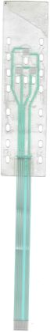

**[Ön işleme] Eğikliği düzeltilmiş görüntü** — `p2_deskew.png`  
0.76° döndürülmüş; tüm ölçümler bu görüntünün piksel koordinatlarında yapıldı. *Ölçüm: kuyruk hattı kayması < 1 px / 1800 px*

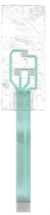

**[Ön işleme] Kontrast güçlendirilmiş (CLAHE)** — `enh.png`  
Saydam film kenarlarını ve yarıkları görmek için yerel kontrast artırıldı.

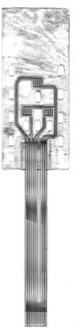

**[Maskeler] İlk hızlı segmentasyon** — `seg.png`  
Gri (gümüş) ve turkuaz (dielektrik) için basit renk eşikleri. Ped içleri dokulu olduğu için delikli çıktı.

**[Maskeler] Baş bölgesi segmentasyonu (çeyrek ölçek)** — `seg_head_q.png`  
Tarak pedleri, dielektrik pencereleri ve ped çevresindeki ince turkuaz çerçeve burada ilk kez görüldü.

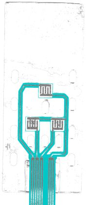

**[Maskeler] Başarısız deneme: global eşik** — `seg2.png`  
L &lt; 212 global eşiği film gölgelerini de gümüş saydı. Yerel arka plan eşiğine geçilmesinin nedeni.

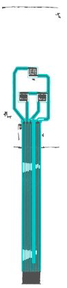

**[Maskeler] Son maske: yerel arka plana göre gümüş + dielektrik** — `seg3.png`  
Gümüş = yerel arka plandan 22 birim koyu ve düşük doygunluklu; dielektrik = G−R &gt; 30.

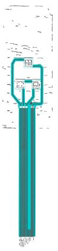

**[Maskeler] Dielektrik şeritleri içindeki gümüş** — `seg4.png`  
Kapatılmış dielektrik alanı içinde turkuaz tonu taşımayan pikseller. Hat merkez çizgilerinin kaynağı; ağ topolojisi bu görüntüden okundu.

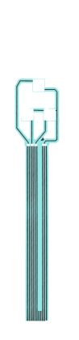

**[Maskeler] Doğrulama referans gümüş maskesi** — `silver_ref.png`  
Şerit içi gümüş ile şerit dışı yerel-koyu pikseller birleştirildi. Gümüş IoU ve kenar sapması buna göre ölçülür.

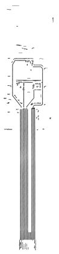

**[Maskeler] Oval kenar gölge maskesi** — `edge.png`  
Film delik kenarlarının koyu gölge çizgileri. Oval stadium fit bu piksellere yapıldı.

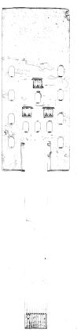

**[Maskeler] Gölge ofseti (film kalkıklığı) haritası** — `golge_haritasi.png`  
Film camdan kalkık olduğunda her gümüş şeklin koyu kopyası δ kadar yukarı düşer. Karolardaki sayı yerel δ (mm), renk mavi (küçük) → kırmızı (büyük); büyük δ = film daha kalkık, kenarlar daha bulanık. Mor = gölge olarak açıklanan pikseller (doğrulamada karşılıksız gümüş ve kenar örneklerinden çıkarılır).

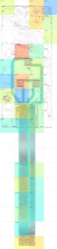

**[Maskeler] Maske / segmentasyon görseli** — `seg_hizli.png`  
Renk ve doku eşikleriyle elde edilen malzeme maskesi.

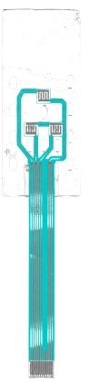

**[Maskeler] Maske / segmentasyon görseli** — `segs_vis.png`  
Renk ve doku eşikleriyle elde edilen malzeme maskesi.

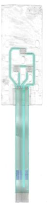

**[Ölçüm] Üst kenar** — `v_top.png`  
Üst kenarın üstündeki gri bant gölge; gerçek kenar bandın alt ucu (px ~213).

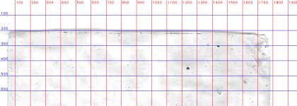

**[Ölçüm] Sol üst köşe** — `v_tl.png`  
Küçük yarıçaplı köşe (~0.5 mm).

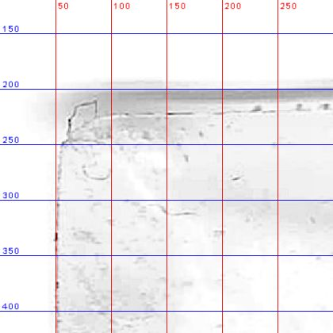

**[Ölçüm] Sağ üst köşe** — `v_tr.png`  
Yaklaşık 1 mm yarıçaplı köşe.

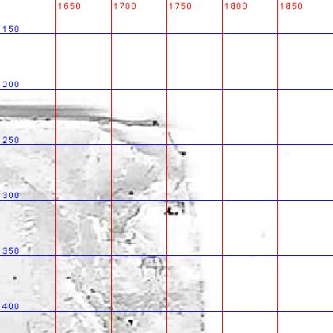

**[Ölçüm] Köşe mozaiği** — `corners.png`  
Dört baş köşesi ve kuyruk ucu köşeleri; 20 px ızgara. Kuyruk ucu köşeleri keskin.

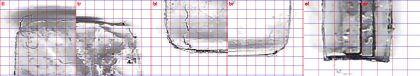

**[Ölçüm] Kuyruk yarıkları (üst)** — `v_rect.png`  
Kuyruğun iki yanında tam yuvarlak uçlu yarıklar. *Ölçüm: yarık 2.0 mm, üst uç y = 71.55 mm*

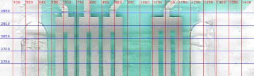

**[Ölçüm] Sol yarık** — `v_l.png`  
Yarık dış kenarı ~541 px, iç kenar = kuyruk kenarı ~635 px.

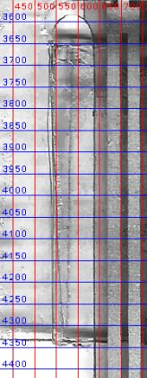

**[Ölçüm] Sağ yarık** — `v_r.png`  
Yarık iç kenarı ~1208 px, dış kenar ~1300 px.

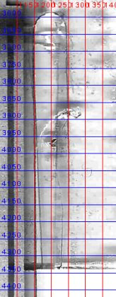

**[Ölçüm] Baş–kuyruk birleşimi** — `v_jn.png`  
Baş alt kenarı y ≈ 4335 px; yarıklar alt kenara açılıyor.

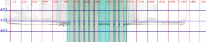

**[Ölçüm] Hat ve dielektrik şerit kesiti** — `v_tr1.png`  
Gümüş hat şeridin ortasında; dielektrik her iki yanda 0.75 mm bindiriyor. *Ölçüm: hat 0.50 mm, şerit 2.02 mm*

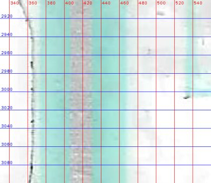

**[Ölçüm] Hat köşe tipleri** — `bends.png`  
Dik köşeler 45° pahlı; sol üst 60°, alt çaprazlar ~51°.

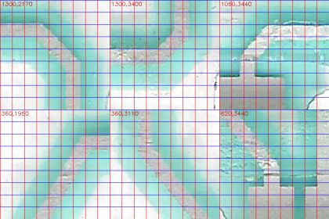

**[Ölçüm] Ped B (yakın)** — `v_padB.png`  
Parmak kenarları ve uç boşlukları.

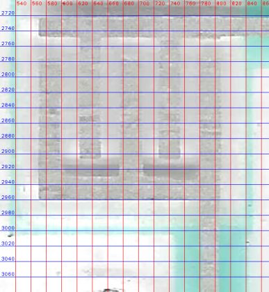

**[Ölçüm] Ped C (yakın)** — `v_padC.png`  
C sol dış parmağından inen hat çapraz olarak 5–6. pozisyonlara gidiyor.

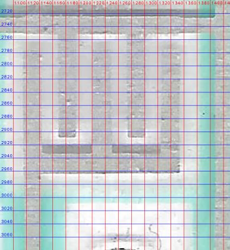

**[Ölçüm] Bağlantı blokları (sol)** — `v_j1.png`  
Her baş hattı 2 kontak genişliğinde bir bloğa giriyor; blok altında hatlar çentikle ayrılıyor. *Ölçüm: blok üstü y = 71.1 mm, çentik y = 72.35 mm*

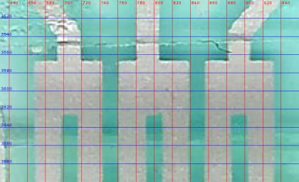

**[Ölçüm] Bağlantı bloğu (ortak ağ)** — `v_j2.png`  
Ortak ağ 3 kontağa (9-10-11) bölünüyor.

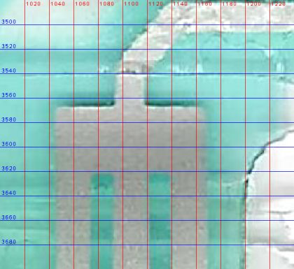

**[Ölçüm] Konnektör ucu yakın çekim** — `v_ct.png`  
Kontaklar uca kadar açık; dummy kontaklar ~y 158.95 mm'de başlıyor. Takviye bölgesinde kontak kenarları kabartma gibi gölgeleniyor. *Ölçüm: adım 47.17 px = 1.00 mm, kontak 0.60 mm*

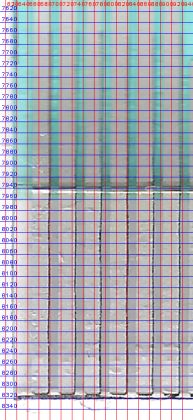

**[Ölçüm] Kuyruk ucu** — `v_end.png`  
Dielektrik bitişi (y 163.9 mm) ve takviye başlangıcı (y 164.0 mm).

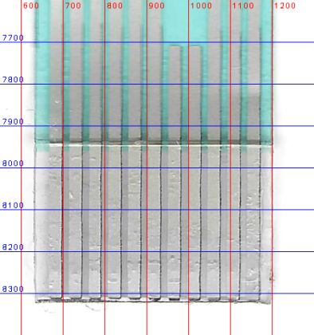

**[Ölçüm] Oval kenarları** — `v_edge.png`  
12 oval: sol/sağ sütunda 4'er, ortada 1 + 3. Alt uçlardaki koyu hilal gölge. *Ölçüm: 3.2 × 6.1 mm, satır adımı 12.7 mm*

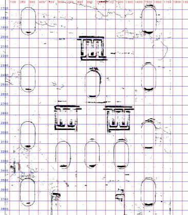

**[Topoloji] Baş bölgesi (ızgaralı)** — `v_head.png`  
Pedler, hatlar ve ovallerin genel yerleşimi. Izgara 200 px (~4.24 mm).

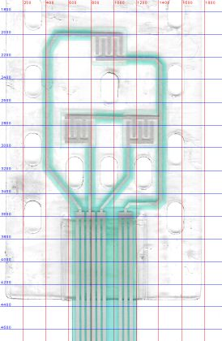

**[Topoloji] Ağ topolojisi** — `v_s4.png`  
4 ağ ve kuyruğa iniş: sol dış hat (A üst), B alt, C alt (çapraz) ve sağ ortak hat (A alt + B/C üst bus).

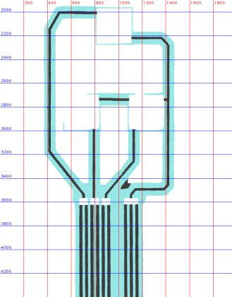

**[Topoloji] Kuyruğa iniş bölgesi** — `v_fan.png`  
Baştan gelen 4 hat, kuyruk başındaki bağlantı bloklarına giriyor.

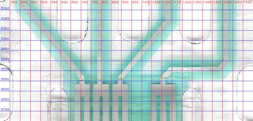

**[Topoloji] Çizimden çıkarılan ağ haritası** — `ag_haritasi.png`  
Çizim geometrisinden çıkarılan elektrik ağları: her ağ ayrı renk, köprüler koyu kontur, altta pin numaraları; kırmızı halka = HATA, turuncu = UYARI, gri = bilinen (kabul edilmiş) bulgu.

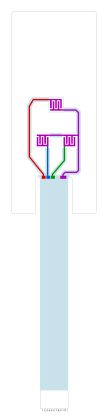

**[Karar kanıtı] Tarak ped A (orijinal renkler)** — `v_padA2.png`  
5 parmak; üst tarakta dış 3 parmak. Barların üstündeki koyu bantlar gölge. *Ölçüm: parmak 0.58, boşluk 0.53, ped 5.02 × 5.02 mm*

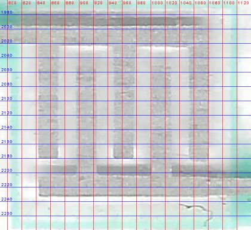

**[Karar kanıtı] Ped A alt barı** — `v_pAb.png`  
Parmak uçları ile alt bar arasındaki koyu bant (2189–2205 px) gölge; alt bar 2205–2233 px.

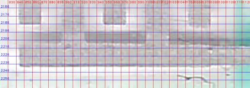

**[Karar kanıtı] Ped B** — `v_pB.png`  
Üst tarakta iç 2 parmak (A'nın tersi). Bus hattı üst barla birleşiyor.

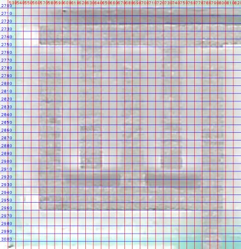

**[Doğrulama] Baş bölgesi bindirme** — `ov_head.png`  
Çizimin tamamı taramanın üstünde; ovaller, pedler, hatlar ve şeritler örtüşüyor.

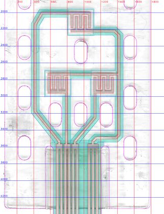

**[Doğrulama] Ped A bindirme** — `ov_padA.png`  
Parmak ve bar kenarları 1–2 px içinde.

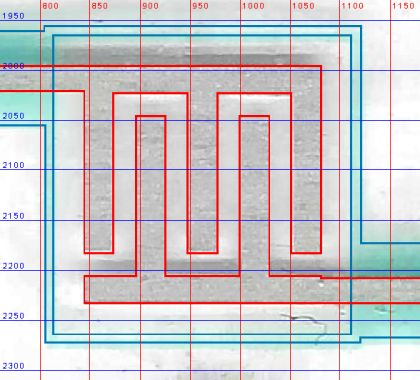

**[Doğrulama] Bağlantı blokları bindirme** — `ov_jn.png`  
Bloklar ve çentikler örtüşüyor.

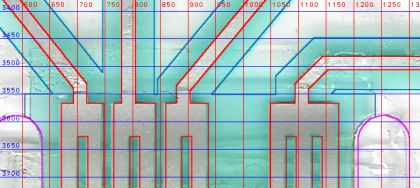

**[Doğrulama] Konnektör ucu bindirme** — `ov_end.png`  
0.6 mm kontaklar, dielektrik sonu ve kuyruk ucu.

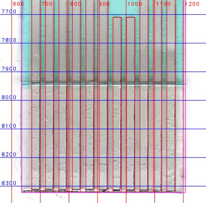

**[Doğrulama] Köşeler ve yarıklar bindirme** — `ov_corners.png`  
Kesim konturu film kenarıyla ±0.1 mm içinde; fark kesimin 0.2° dönüklüğünden.

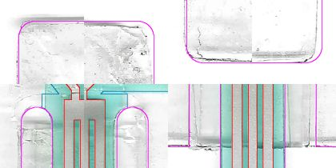

**[Doğrulama] Rapor kontrol kırpımı: bas bolgesi** — `kontrol_bas_bolgesi.png`  
Doğrulama bindirmesinden kırpım. Bindirme renkleri: kırmızı gümüş (alt baskı), mavi köprü (2. baskı), yeşil dielektrik, mor kesim/oval, turuncu taramada olup çizimde karşılığı olmayan gümüş.

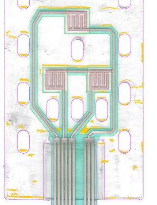

**[Doğrulama] Rapor kontrol kırpımı: konnektor ucu** — `kontrol_konnektor_ucu.png`  
Doğrulama bindirmesinden kırpım. Bindirme renkleri: kırmızı gümüş (alt baskı), mavi köprü (2. baskı), yeşil dielektrik, mor kesim/oval, turuncu taramada olup çizimde karşılığı olmayan gümüş.

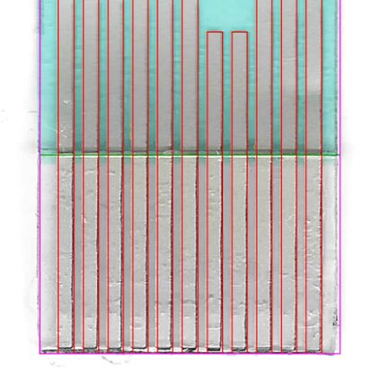

**[Doğrulama] Rapor kontrol kırpımı: kuyruk baglantisi** — `kontrol_kuyruk_baglantisi.png`  
Doğrulama bindirmesinden kırpım. Bindirme renkleri: kırmızı gümüş (alt baskı), mavi köprü (2. baskı), yeşil dielektrik, mor kesim/oval, turuncu taramada olup çizimde karşılığı olmayan gümüş.

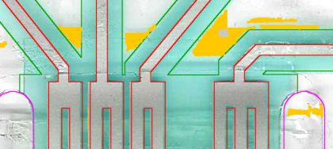

**[Doğrulama] Rapor kontrol kırpımı: ped a** — `kontrol_ped_A.png`  
Doğrulama bindirmesinden kırpım. Bindirme renkleri: kırmızı gümüş (alt baskı), mavi köprü (2. baskı), yeşil dielektrik, mor kesim/oval, turuncu taramada olup çizimde karşılığı olmayan gümüş.

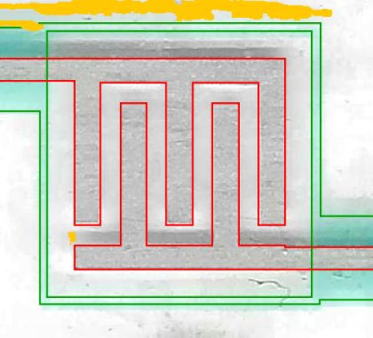

**[Doğrulama] Kenar sapması ısı haritası: bas bolgesi** — `kontrol_sapma_bas_bolgesi.png`  
Çizimin her kenar örneğinde taramadaki malzeme kenarına alt-piksel uzaklık: yeşil ≤ 0.02 mm, sarı ≤ 0.05, turuncu ≤ 0.10, kırmızı > 0.10 mm, mor taramada karşılık bulunamadı (eleman yanlış yerde ya da referans maske orada eksik).

**[Doğrulama] Kenar sapması ısı haritası: konnektor ucu** — `kontrol_sapma_konnektor_ucu.png`  
Çizimin her kenar örneğinde taramadaki malzeme kenarına alt-piksel uzaklık: yeşil ≤ 0.02 mm, sarı ≤ 0.05, turuncu ≤ 0.10, kırmızı > 0.10 mm, mor taramada karşılık bulunamadı (eleman yanlış yerde ya da referans maske orada eksik).

**[Doğrulama] Kenar sapması ısı haritası: kuyruk baglantisi** — `kontrol_sapma_kuyruk_baglantisi.png`  
Çizimin her kenar örneğinde taramadaki malzeme kenarına alt-piksel uzaklık: yeşil ≤ 0.02 mm, sarı ≤ 0.05, turuncu ≤ 0.10, kırmızı > 0.10 mm, mor taramada karşılık bulunamadı (eleman yanlış yerde ya da referans maske orada eksik).

**[Doğrulama] Kenar sapması ısı haritası: ped a** — `kontrol_sapma_ped_A.png`  
Çizimin her kenar örneğinde taramadaki malzeme kenarına alt-piksel uzaklık: yeşil ≤ 0.02 mm, sarı ≤ 0.05, turuncu ≤ 0.10, kırmızı > 0.10 mm, mor taramada karşılık bulunamadı (eleman yanlış yerde ya da referans maske orada eksik).

**[Doğrulama] Kenar sapması ısı haritası: tamamı** — `ov_sapma.png`  
Çizimin her kenar örneğinde taramadaki malzeme kenarına alt-piksel uzaklık: yeşil ≤ 0.02 mm, sarı ≤ 0.05, turuncu ≤ 0.10, kırmızı > 0.10 mm, mor taramada karşılık bulunamadı (eleman yanlış yerde ya da referans maske orada eksik).

**[Doğrulama] Taramaya bindirme** — `overlay.png`  
Çizim geometrisi taramanın üstüne çizildi. Bindirme renkleri: kırmızı gümüş (alt baskı), mavi köprü (2. baskı), yeşil dielektrik, mor kesim/oval, turuncu taramada olup çizimde karşılığı olmayan gümüş.

**[Çıktı kontrolü] Üretim PDF'i: baş bölgesi** — `pdf_head.png`  
PDF rasterleştirildi: katmanlar, renkler ve kesim yayları doğru.

**[Çıktı kontrolü] Üretim PDF'i: tamamı** — `pdf_all.png`  
1:1 mm sayfa, her yanda 5 mm boşluk.

**[Çıktı kontrolü] Üretim PDF'i: konnektör ucu** — `pdf_tailend.png`  
Kontaklar, dummy kontaklar ve takviye.

**[Çıktı kontrolü] Çıktı render kontrolü** — `_tarama/r_P2_kontrol_taramali.png`  
Üretilen SVG/PDF dosyasının rasterleştirilmiş önizlemesi.

**[Çıktı kontrolü] Çıktı render kontrolü** — `r_P2_duzenlenebilir.png`  
Üretilen SVG/PDF dosyasının rasterleştirilmiş önizlemesi.

**[Çıktı kontrolü] Çıktı render kontrolü** — `r_P2_uretim.png`  
Üretilen SVG/PDF dosyasının rasterleştirilmiş önizlemesi.

**[Çalışma görüntüleri] Izgaralı yakın çekim** — `v_h0.png`  
Ölçüm ve okuma için üretilmiş ızgaralı kırpım (ızgara etiketleri tarama pikseli).

**[Çalışma görüntüleri] Izgaralı yakın çekim** — `v_h1.png`  
Ölçüm ve okuma için üretilmiş ızgaralı kırpım (ızgara etiketleri tarama pikseli).

**[Çalışma görüntüleri] Izgaralı yakın çekim** — `v_h2.png`  
Ölçüm ve okuma için üretilmiş ızgaralı kırpım (ızgara etiketleri tarama pikseli).

**[Çalışma görüntüleri] Izgaralı yakın çekim** — `v_padA.png`  
Ölçüm ve okuma için üretilmiş ızgaralı kırpım (ızgara etiketleri tarama pikseli).

**[Çalışma görüntüleri] Izgaralı yakın çekim** — `v_s2A.png`  
Ölçüm ve okuma için üretilmiş ızgaralı kırpım (ızgara etiketleri tarama pikseli).

**[Çalışma görüntüleri] Izgaralı yakın çekim** — `v_s3.png`  
Ölçüm ve okuma için üretilmiş ızgaralı kırpım (ızgara etiketleri tarama pikseli).

**[Çalışma görüntüleri] Izgaralı yakın çekim** — `v_s3A.png`  
Ölçüm ve okuma için üretilmiş ızgaralı kırpım (ızgara etiketleri tarama pikseli).

## Çıktılar

- `output/P2_duzenlenebilir.svg` — CorelDRAW'da düzenleme (hatlar kalınlıklı çizgi, pedler dikdörtgen)
- `output/P2_uretim.svg` — Üretim: her katman tek kapalı dolgu
- `output/P2_uretim.pdf` — Üretim: katmanlı vektör PDF
- `output/P2_kontrol_taramali.svg` — Kontrol: çizim + altta hizalı tarama