# P3 - Uzun LED devresi (20 LED, 11 pin 1.0 mm)

*12.11.2026 00:50 — fpc-vektor skill · etkileşimli sürüm: `P3_rapor.html`*

**Kabul:** KALDI · **Belirsiz rota:** 12 · **Kontrol maddesi:** 19 · **Karar noktası:** 8

## Özet

20 LED'li arka aydınlatma katmanı (0402 LED). İki gümüş baskı (alt hatlar + dielektrik üstü köprüler), dielektrik köprü yamaları, 11 pinlik 1.0 mm ZIF kuyruğu; LED'ler matris bağlı (her pin birden çok LED'i sürüyor). P4 tuş katmanıyla üst üste biner: LED'ler P4'ün 20 oval penceresinin altındadır.

## Analiz süreci

1. **Kaynağın incelenmesi** — K.pdf'teki 3. parça; tip = LED. Baş sağ üstü çapraz/dalgalı biçimde kesilmiş; sol üst köşe orijinal (R0.3) duruyor. Kuyrukta beyaz etiket var.
2. **Kırpım ve eğiklik** — Genel eğiklik 0.68°. Bölge bazında 0.56–0.73°; düzeltme sonrası baş hatları ≤ 0.08°, kuyruk −0.03° — P4'teki gibi bükülme düzeltmesine gerek kalmadı.
3. **Maskeler: doku yerine koyuluk** — LED tipi doku maskesi (m_top) sağ yarıda bulanıklık yüzünden dikey hatları kaybediyordu. segment_led.py'ye yerel arka plana göre koyuluk maskesi (m_dark) eklendi; rota oturtma bu maskeyle, doğrulama ise gölge çekirdeği ayıklanmış bant maskesiyle (m_band, 178 ≤ L ≤ 218) yapıldı.
4. **Ölçek ve kontur** — Kuyrukta 11 hattın adımı 47.07 px (47.17 ile 0.998 mm); ortak ölçek korundu. Baş 36.6 × 138.55 mm, yarıklar 2.1 mm (üst ucu 122.6), kuyruk P4 ile aynı biçimde 11.35 → 11.8 mm genişliyor. Toplam boy 263.4 mm.
5. **LED'ler ve polarite** — 20 yeşil çip T > 45 bileşenlerinden bulundu. Pedler kaplama damlası altında; P1 şablonu (1.65 × 1.6, boşluk 0.85) kullanıldı. '+' işaretleri şablon eşleştirmeyle: sol sütunda alt-sağ (+57,+111 px), sağ sütun ve ortada alt-sol (−47,+113 / −48,+99 px) — hepsi alt ped yanında.
6. **Topoloji okuma** — Yüksek geçiren görüntü (L − Gauss25) ızgaralı karolarda bölge bölge okundu; m_dark segment listesinden kesin koordinatlar alındı. Kenarlarda çift dikey hat (dış = R1 ortak / R2 alt, iç = Na / Nb), ortada 8 hatlık bus, altı sırada yama.
7. **Yama geçişleri** — Her yamada sütun bazlı renk profili alındı (gri G−R≈0 = üst baskı, koyu turkuaz G−R>90 & R<95 = alt baskı). Bus yamalarında dikeyler üstten, yataylar alttan geçiyor; yatayın bağlandığı hat yamanın dışındaki ilk hat. Tasarımda köprü seçimi aynı renk kuralıyla otomatik; kesişen hatların üstündeki pikseller örneklenmiyor.
8. **Rotalar ve gölge düzeltmesi** — 58 hat (47 rota + 11 kontak) refine ile oturtuldu; m_dark gölgeyi de içerdiği için yatay hatların y'si alt kenardan yeniden hesaplandı. Ağ mantığı çizim geometrisinden çıkarıldı (pedler → pinler).
9. **Üretim ve doğrulama** — Gümüş kenar sapması 0.042 / 0.131 mm (eşik içinde). Karşılıksız tarama gümüşü 0.207 (eşik 0.15): 0.088'i LED kaplama damlaları, 0.014'ü çift hatlar arasındaki bulanık boşluk, kalanı gölge ve bulanık kenarlar. İki iyileştirme turundan sonra kullanıcının seçimiyle (devam et, işaretle) bu haliyle teslim.

## Bulgular

- Yapı: alt gümüş + 16 dielektrik köprü yaması + üst gümüş köprüler (45 parça) + 20 LED + '+' işaretleri; kuyrukta dielektrik, takviye ve etiket.
- Matris bağlantı: üst pedler pin 1/2/3/4/5/7'ye, alt pedler pin 4/6/7/8/9/10/11'e. L2 ve R4 aynı pin çiftinde (7–8), paralel.
- L5 ve R5 alt pedleri y≈4487 px yaması altında yalnızca birbirine bağlı; çizimde pinsiz. Taramada yama içinde altı dikeyin hepsi üstten geçiyor görünüyor; ya bir dikey aslında alttan geçiyor ya da bağlantı bulanıklıkta okunamıyor.
- Çizimde pin 1 (R1 ortak) ile pin 8 (Y) aynı ağda: V465 hattı sol alt döngüyle birleşik görünüyor. Kısa devre yaratmıyor ama iki pinli ağ şüpheli.
- LED konumları P4 ovalleriyle x'te ≤ 0.11 mm, y'de (sabit 2.6 mm kayma dışında) ≤ 0.21 mm örtüşüyor. P3 başı LED'lere göre P4'ten 2.6 mm kısa: üst kenar da kırpılmış olabilir.
- Kuyruk P4 ile aynı biçimde baş altında 11.35 mm, sonra 11.8 mm — bu bir kesim tasarımı (iki parçada birden).
- Konnektörde dummy yok: 11 kontağın hepsi kullanılıyor.
- Film sağ yarıda camdan kalkık: hatlar bulanık, doku eşiği çalışmıyor; yatay hatların 20–28 px üstünde gölge kopyası var.

## Karar noktaları

### K1. Belirsiz bağlantılarla devam

- Seçenek: Devam et, işaretle
- Seçenek: Yeni tarama
- Seçenek: Multimetreyle doğrulama
- **Seçilen:** Devam et, işaretle
- Gerekçe: Kullanıcı seçimi; belirsiz rotalar Kontrol katmanında ve kontrol listesinde.

### K2. Kesik üst kenar

- Seçenek: Dikdörtgen + kontrol izi
- Seçenek: Taramadaki gibi kesik
- **Seçilen:** Dikdörtgen + kontrol izi
- Gerekçe: Kesim P4 gibi dikdörtgen; taramadaki kenar Kontrol katmanında 'Taramadaki_kesik_ust_kenar'.
- Kanıt: [v_top.png](P3_rapor_gorseller/v_top.jpg)

### K3. Hat maskesi

- Seçenek: Doku maskesi (m_top | m_under)
- Seçenek: Koyuluk maskesi (m_dark)
- **Seçilen:** Rota için m_dark, doğrulama için gölge çekirdeği ayıklanmış m_band
- Gerekçe: m_top sağ yarıda dikey hatların çoğunu kaybediyordu; m_dark gölgeyi içerdiğinden yataylar alt kenardan düzeltildi. m_band ile kenar %90 0.165 → 0.131 mm.
- Kanıt: [m_dark_3150.png](P3_rapor_gorseller/m_dark_3150.jpg), [seg_led.png](P3_rapor_gorseller/seg_led.jpg)

### K4. Köprü seçimi

- Seçenek: Maske örneklemesi (P1 yöntemi)
- Seçenek: Renk örneklemesi (gri / koyu turkuaz)
- **Seçilen:** Renk örneklemesi, kesişen hatların üstü hariç
- Gerekçe: Bulanık bölgede m_top üst baskıyı görmüyor; renk profili yamalarda net ayrım veriyor (G−R 0 vs 130).
- Risk: 3 yamada renk kararsızdı, elle ayarlandı (x1418/y3200, poz4/Q, L6 alt).
- Kanıt: [v_yama_4480.png](P3_rapor_gorseller/v_yama_4480.jpg), [v_yama_5100.png](P3_rapor_gorseller/v_yama_5100.jpg)

### K5. B2 / Z çapraz bölgesi

- Seçenek: Çaprazlama: Z → poz 5, B2 → poz 4
- Seçenek: Düz: Z → poz 4, B2 → poz 5
- **Seçilen:** Düz (Z → pin 4, B2 alt → pin 6)
- Gerekçe: Z bandı yamanın altında kesintisiz x≈918'e iniyor; çaprazlama çizimde 18 px aralıkla iki hattı üst üste bindiriyordu.
- Risk: Yama varlığı çaprazlamayı da destekliyor; Kontrol katmanında.
- Kanıt: [v_bz_capraz.png](P3_rapor_gorseller/v_bz_capraz.jpg)

### K6. L1 alt hattının sol ucu

- Seçenek: Sol dış hatta bağlı
- Seçenek: Boşluk var
- **Seçilen:** Boşluk (hat x≈222 px'te bitiyor)
- Gerekçe: Profilde 8 px'lik hafif tepe var; bağlı olsaydı L1'in iki pedi aynı ağda olurdu (kısa devre).
- Kanıt: [v_L1_bosluk.png](P3_rapor_gorseller/v_L1_bosluk.jpg)

### K7. Sol alt döngü ve yelpaze

- Seçenek: R1 ortak → pin 1
- Seçenek: R1 ortak → pin 8
- **Seçilen:** İkisi de (geometride birleşik), Kontrol katmanında
- Gerekçe: Bölge bulanık; m_dark'ta x≈465 hattı döngüye kesintisiz iniyor.
- Kanıt: [v_sol_alt.png](P3_rapor_gorseller/v_sol_alt.jpg)

### K8. Kabul kapısı

- Seçenek: ROI'yi daralt
- Seçenek: Kümeleri sınıflandırıp rapora yaz
- **Seçilen:** Rapora yaz (karşılıksız 0.207)
- Gerekçe: Kümeler sınıflandırıldı: kaplama 0.088, çift hat boşluğu 0.014, kalan gölge/bulanık kenar. Çizilmemiş hat kümesi kalmadı.
- Kanıt: [overlay.png](P3_rapor_gorseller/overlay.jpg), [kontrol_bas_ust.png](P3_rapor_gorseller/kontrol_bas_ust.jpg)

## Ölçüler

| Ölçü | Değer | Not |
|---|---|---|
| Baş (genişlik × yükseklik) | 36.6 × 138.55 mm | köşe R0.3; sağ üst köşe numunede kesik |
| Toplam boy | 263.4 mm |  |
| Kuyruk genişliği | 11.35 → 11.8 mm | y=138.2–159.4 arasında genişler |
| Yarık | 2.1 mm | üst ucu y=122.6 |
| Konnektör | 11 poz × 1.0 mm | kontak 0.6 mm, dummy yok |
| Hat genişliği | 0.5 mm |  |
| LED pedi | 1.65 × 1.6 mm | boşluk 0.85 mm, LED gövdesi 0.5 × 1.0 mm |
| Polarite işareti | + 0.8 mm, çizgi 0.15 mm | gümüş baskı, alt ped yanında |
| Köprü bindirmesi | 0.4 mm | yama kenarından dışarı |
| Kart sınır kutusu | 36.60 × 263.40 mm | Kesim konturu |
| Kart alanı | 6473.4 mm² |  |
| Gümüş alanı (alt baskı) | 1591.9 mm² |  |
| Dielektrik alanı | 1791.6 mm² |  |
| Köprü alanı (2. gümüş baskı) | 86.90 mm² | 43 köprü |

| Eleman | Adet |
|---|---|
| Hat (polyline) | 58 |
| Gümüş dikdörtgen (ped/blok/parmak) | 40 |
| Oval pencere | 0 |
| LED | 20 |
| Dielektrik yama | 16 |
| Köprü | 43 |
| Kontrol (belirsiz) rota | 12 |

### Varsayımlar

- Ölçek 47.17 px/mm (setin ortak kalibrasyonu); P3 kuyruğunda adım 0.998 mm ölçüldü.
- Baş sağ üst bölgesi numunede çapraz kesik/yırtık; kesim konturu P4 gibi dikdörtgen çizildi, taramadaki kenar Kontrol katmanında ayrıca verildi.
- Film sağ yarıda camdan kalkık (bulanık): hat maskesi doku yerine koyuluktan (m_dark) çıkarıldı; yatay hatların konumu gölge kopyasından etkilenmeyen alt kenardan alındı.
- Köprülerde üst/alt seçimi yama içinde renkten yapıldı (gri = üst baskı, koyu turkuaz = alt baskı).
- LED ped/gövde ölçüleri P1 şablonu: kaplama damlaları ped kenarlarını örtüyor.
- Kesim deseni baskıya göre ~0.1° dönük; çizimde ideal hizalı alındı.

## Doğrulama

| Metrik | Değer | Eşik | Sonuç |
|---|---|---|---|
| Gümüş kenar sapması medyan | 0.042 mm | ≤ 0.06 mm | ✔ |
| Gümüş kenar sapması %90 | 0.131 mm | ≤ 0.15 mm | ✔ |
| Gümüş IoU | 0.563 | bilgi | — |
| Taramada karşılıksız gümüş | 0.207 | ≤ 0.15 | ✘ |

## Pin eşlemesi

| Pin | Bağlantı |
|---|---|
| 1 | R1 ortak: üst yatay + sol dış hat (sol alt döngü üzerinden); çizimde pin 8 ile aynı ağ |
| 2 | L8 üst pedi |
| 3 | Na: L3–L7 üst pedleri (sol iç hat) |
| 4 | Z + Q: C1/B1/B2/B3 üst, R8 üst, L6 alt |
| 5 | Nb: R3, R5, R6, R7 üst pedleri (sağ iç hat) |
| 6 | B2 alt |
| 7 | X: L1 alt, L2 üst, L3 alt, R3 alt, R4 üst, B3 alt |
| 8 | Y: L2/L4/R4/B1 alt + V465 (+ R1 ortak) |
| 9 | R1 alt + C1 alt |
| 10 | R2 alt + R6 alt |
| 11 | L7/R7/R8 alt |

## Fiziksel kontrol

- [ ] Kuyruk pin eşlemesi (aşağıdaki tablo) — sol yelpaze (pin 1-3) ve sol alt döngü bulanık bölgede yorumlandı
- [ ] Pin 1 ve pin 8 çizimde aynı ağda (R1 ortak = Y): V465 hattının alt ucu sol alt döngüye gerçekten bağlı mı?
- [ ] L5 ve R5 alt pedleri: y≈4487 px yaması altında birbirine bağlı, hiçbir pine ulaşmıyor görünüyor (multimetre)
- [ ] L1 alt hattının (X) sol ucu ile sol dış ortak hat arasında boşluk var mı? (birleşikse L1 kısa devre olur)
- [ ] B2/Z çapraz yaması (y≈3410-3560 px): Z → pin 4, B2 alt → pin 6 olarak yorumlandı (tersi de mümkün)
- [ ] R8 üst pedi → sağ dış alt hat → pin 4 ve R8 alt pedi → noktalı hat → pin 11 bağlantıları
- [ ] L8 üst pedi → pin 2, L8 alt pedi → sol alt döngü (ortak) bağlantıları
- [ ] Kontrol katmanı: 'Taramadaki_kesik_ust_kenar' rotası taramadan kesin okunamadı
- [ ] Kontrol katmanı: 'X_hat' rotası taramadan kesin okunamadı
- [ ] Kontrol katmanı: 'V465' rotası taramadan kesin okunamadı
- [ ] Kontrol katmanı: 'Na' rotası taramadan kesin okunamadı
- [ ] Kontrol katmanı: 'Z_C1' rotası taramadan kesin okunamadı
- [ ] Kontrol katmanı: 'B2_alt' rotası taramadan kesin okunamadı
- [ ] Kontrol katmanı: 'Q_R8' rotası taramadan kesin okunamadı
- [ ] Kontrol katmanı: 'L5R5_alt' rotası taramadan kesin okunamadı
- [ ] Kontrol katmanı: 'R8_alt' rotası taramadan kesin okunamadı
- [ ] Kontrol katmanı: 'L8_ust' rotası taramadan kesin okunamadı
- [ ] Kontrol katmanı: 'R1_sol_alt' rotası taramadan kesin okunamadı
- [ ] Kontrol katmanı: 'L8_alt' rotası taramadan kesin okunamadı

## Daha iyi sonuç için

- **Multimetre testi (öncelikli):** Kuyruktan pin–pin ölçün: pin 1–8 kısa mı? L5/R5 alt pedleri hangi pine bağlı? B2 alt pin 6'da mı, Z (C1/B üstleri) pin 4'te mi? Sonuçları bildirirseniz rotalar tek satırla düzeltilir.
- **Yeni tarama:** Filmi cam/düz karton ile bastırın, mümkünse arkadan aydınlatın, 1200–2400 dpi. Sağ yarıdaki bulanıklık ve gölge kopyaları ortadan kalkarsa yama geçişleri ve döngüler kesinleşir.
- **Orijinal üst kenar:** Kesilmemiş bir P3 numunesi veya baş ölçüsü varsa bildirin; LED'lere göre P4'ten 2.6 mm kısa olan baş yüksekliği düzeltilir.
- **LED tipi:** LED datasheet'i (0402 ped ölçüleri) şablon pedleri kesinleştirir.

## Analiz görselleri

**[Kaynak] P3 önizleme** — `_tarama/parca_3.png`  
~150 dpi: 20 LED, köprü yamaları, kesik sağ üst köşe, kuyrukta etiket.

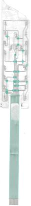

**[Kaynak] Deskew sonrası tamamı** — `v_all.png`  
0.075 ölçek, ızgara 1000 px.

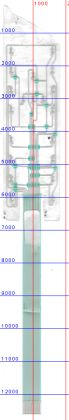

**[Kaynak] Kaynak görüntü** — `_tarama/genel.png`  
Taramadan kırpılan / incelenen ham görüntü.

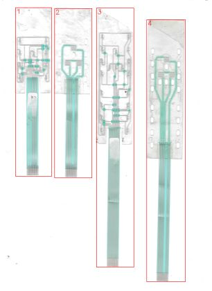

**[Kaynak] Kaynak görüntü** — `_tarama/parca_1.png`  
Taramadan kırpılan / incelenen ham görüntü.

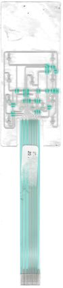

**[Kaynak] Kaynak görüntü** — `_tarama/parca_2.png`  
Taramadan kırpılan / incelenen ham görüntü.

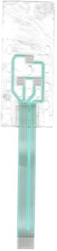

**[Kaynak] Kaynak görüntü** — `_tarama/parca_4.png`  
Taramadan kırpılan / incelenen ham görüntü.

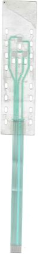

**[Ön işleme] Eğiklik düzeltilmiş görüntü** — `p3_deskew.png`  
0.68° döndürülmüş; ölçümler bu koordinatlarda.

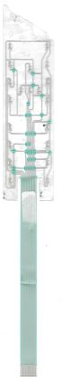

**[Maskeler] LED tipi doku maskeleri** — `seg_led.png`  
m_top sağ yarıda dikey hatları kaybediyor (bulanıklık).

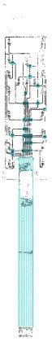

**[Maskeler] Koyuluk maskesi (üst)** — `m_dark_1350.png`  
Gri: m_dark, mavi: dielektrik altı gümüş. Izgara 100 px.

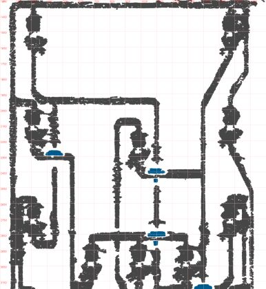

**[Maskeler] Koyuluk maskesi (orta)** — `m_dark_3150.png`  
Bus ve yama sıraları.

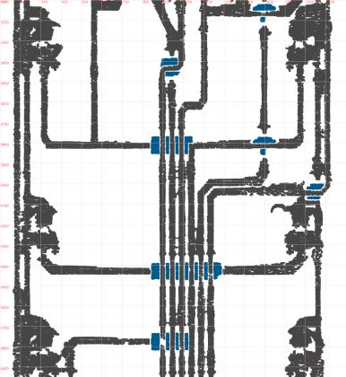

**[Maskeler] Koyuluk maskesi (alt)** — `m_dark_4950.png`  
Sol yelpaze, kuyruk başlangıcı ve sağ alt LED'ler.

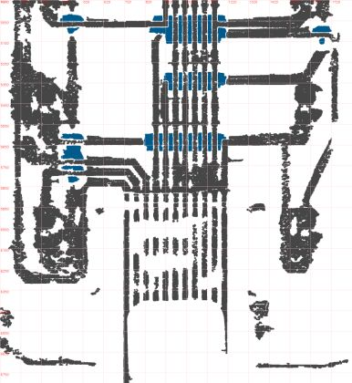

**[Maskeler] Maske / segmentasyon görseli** — `seg_hizli.png`  
Renk ve doku eşikleriyle elde edilen malzeme maskesi.

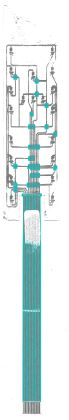

**[Ölçüm] Sol yarık** — `v_slotL.png`  
Dış kenar ≈597, iç (kuyruk) ≈698 px; üst yay ≈5967 px.

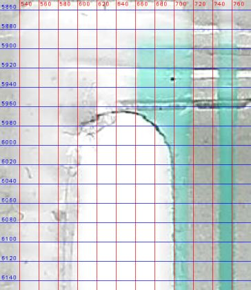

**[Ölçüm] Sağ yarık** — `v_slotR.png`  
İç ≈1236, dış ≈1330 px; üst yay ≈5960 px. Ortalama yarık 2.1 mm.

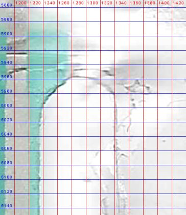

**[Ölçüm] Konnektör ucu** — `v_ct.png`  
11 kontak, takviye kenarı 12219 px, dielektrik bitişi 12241 px, uç 12604 px. *Ölçüm: takviye 255.2, uç 263.4 mm*

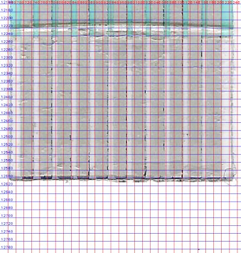

**[Ölçüm] 20 LED ve '+' işaretleri** — `v_led_mozaik.png`  
Her karede çip merkezi kırmızı nokta, ızgara 20 px. '+' hep alt ped yanında.

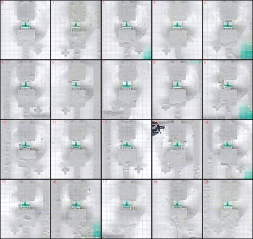

**[Ölçüm] LED L1 yakın** — `v_led_L1.png`  
Pedler kaplama damlası altında; şablon kullanıldı.

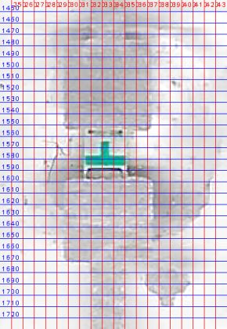

**[Ölçüm] LED C1 yakın** — `v_led_C1.png`  
Gövde merkezi çipten (+3, +5) px.

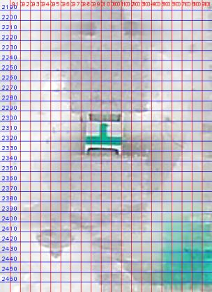

**[Topoloji] Baş üst yarı** — `v_head1.png`  
Izgara 200 px.

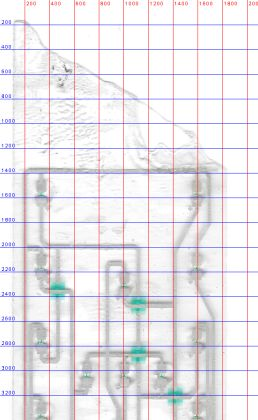

**[Topoloji] Baş alt yarı** — `v_head2.png`  
Bus, yama sıraları ve kuyruk başlangıcı.

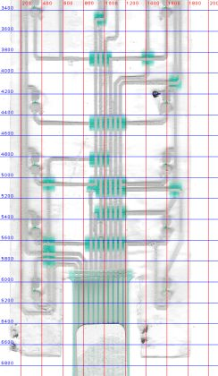

**[Topoloji] Okuma karosu y 1350–2200** — `v_t_1350.png`  
Üst yatay (R1 ortak), L1/R1, X yatayı, R1 katot çaprazı.

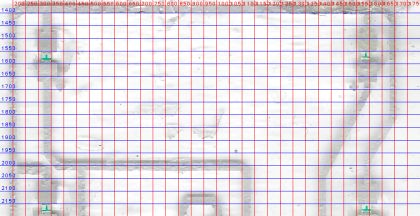

**[Topoloji] Okuma karosu y 2150–3000** — `v_t_2150.png`  
L2/L3, C1 Π yapısı, Z yatayı.

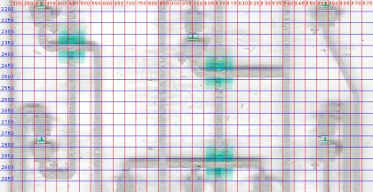

**[Topoloji] Okuma karosu y 2950–3800** — `v_t_2950.png`  
B sırası, X/R3R4 yatayı, B2/Z çaprazı.

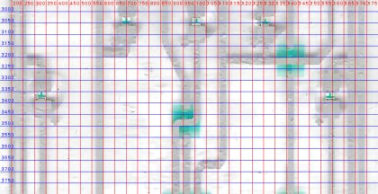

**[Topoloji] Okuma karosu y 3750–4600** — `v_t_3750.png`  
Y yatayı (poz 7), R1/R2 katotları bus'a, L5/R5 yaması.

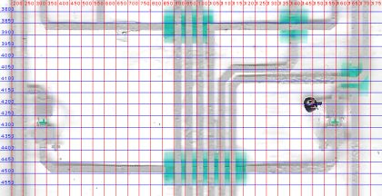

**[Topoloji] Okuma karosu y 4550–5400** — `v_t_4550.png`  
V465, L6/R6, Q ve Nb yamaları.

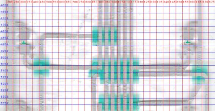

**[Topoloji] Okuma karosu y 5350–6200** — `v_t_5350.png`  
L7/R7/R8 katot yatayı (poz 11), sol yelpaze, L8/R8.

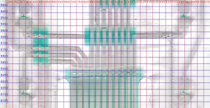

**[Topoloji] Son rotalar taramada** — `routes_son.png`  
Refine edilmiş tüm rotalar, renkli; adlar rota ortasında.

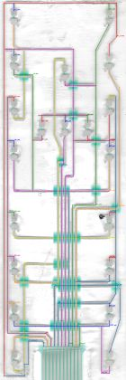

**[Karar kanıtı] Kesik üst kenar** — `v_top.png`  
Sol üst köşe (x≈105, y≈180 px) orijinal; oradan sağa doğru çapraz/dalgalı kesik.

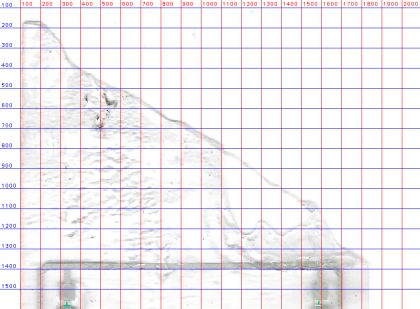

**[Karar kanıtı] Yama y≈3866 px** — `v_yama_3866.png`  
Gri dikeyler (poz 4-6) üstten; yatay alttan geçip poz 7'ye bağlanıyor.

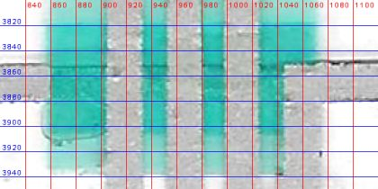

**[Karar kanıtı] Yama y≈4487 px (L5/R5)** — `v_yama_4480.png`  
Altı dikey üstten; yatay yama boyunca alttan — hiçbir bus hattına bağlanmıyor.

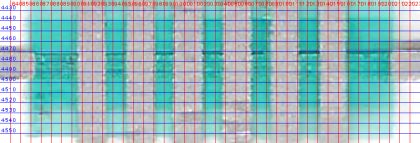

**[Karar kanıtı] Çift yama y≈5060/5110 px** — `v_yama_5100.png`  
L6 alt soldan üstten poz 4'e, R6 alt sağdan poz 9'a, Q sağdan alttan poz 3'e.

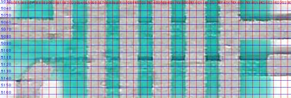

**[Karar kanıtı] B2 / Z çapraz bölgesi** — `v_bz_capraz.png`  
Yüksek geçiren görüntü: sol (Z) çapraz bandı x≈918'e kesintisiz iniyor; sağ (B2) x≈992.

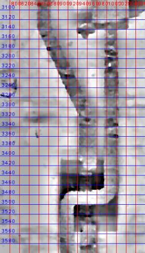

**[Karar kanıtı] L1 alt hattı sol ucu** — `v_L1_bosluk.png`  
Yatay x≈215'te başlıyor; sol dış hatla arasında zayıf parlak boşluk.

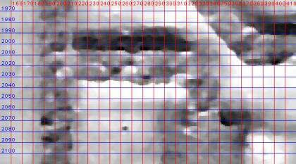

**[Karar kanıtı] Sol alt döngü** — `v_sol_alt.png`  
Bulanık; x≈200, x≈465 ve y≈6300 hatları, yelpaze yaması.

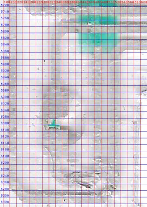

**[Doğrulama] Rapor kontrol kırpımı: b sirasi** — `kontrol_b_sirasi.png`  
Doğrulama bindirmesinden kırpım. Bindirme renkleri: kırmızı gümüş (alt baskı), mavi köprü (2. baskı), yeşil dielektrik, mor kesim/oval, turuncu taramada olup çizimde karşılığı olmayan gümüş.

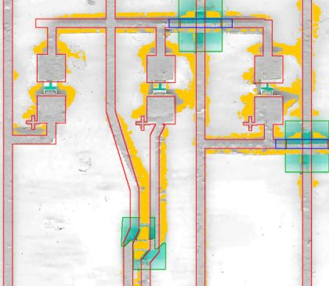

**[Doğrulama] Rapor kontrol kırpımı: bas alt** — `kontrol_bas_alt.png`  
Doğrulama bindirmesinden kırpım. Bindirme renkleri: kırmızı gümüş (alt baskı), mavi köprü (2. baskı), yeşil dielektrik, mor kesim/oval, turuncu taramada olup çizimde karşılığı olmayan gümüş.

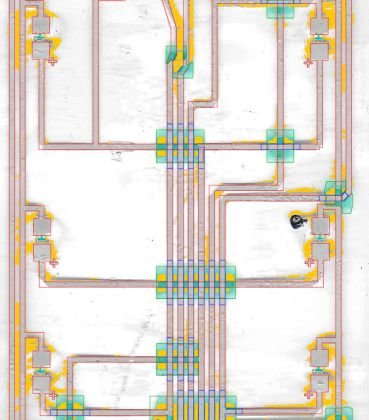

**[Doğrulama] Rapor kontrol kırpımı: bas ust** — `kontrol_bas_ust.png`  
Doğrulama bindirmesinden kırpım. Bindirme renkleri: kırmızı gümüş (alt baskı), mavi köprü (2. baskı), yeşil dielektrik, mor kesim/oval, turuncu taramada olup çizimde karşılığı olmayan gümüş.

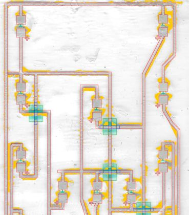

**[Doğrulama] Rapor kontrol kırpımı: bas yelpaze** — `kontrol_bas_yelpaze.png`  
Doğrulama bindirmesinden kırpım. Bindirme renkleri: kırmızı gümüş (alt baskı), mavi köprü (2. baskı), yeşil dielektrik, mor kesim/oval, turuncu taramada olup çizimde karşılığı olmayan gümüş.

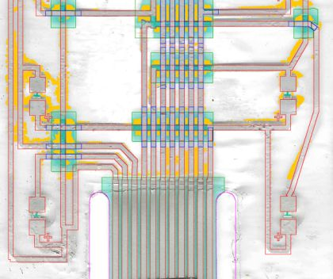

**[Doğrulama] Rapor kontrol kırpımı: konnektor ucu** — `kontrol_konnektor_ucu.png`  
Doğrulama bindirmesinden kırpım. Bindirme renkleri: kırmızı gümüş (alt baskı), mavi köprü (2. baskı), yeşil dielektrik, mor kesim/oval, turuncu taramada olup çizimde karşılığı olmayan gümüş.

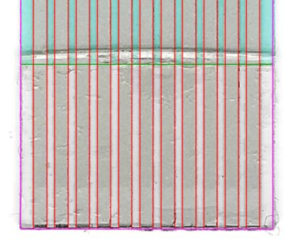

**[Doğrulama] Rapor kontrol kırpımı: yama sirasi 4480** — `kontrol_yama_sirasi_4480.png`  
Doğrulama bindirmesinden kırpım. Bindirme renkleri: kırmızı gümüş (alt baskı), mavi köprü (2. baskı), yeşil dielektrik, mor kesim/oval, turuncu taramada olup çizimde karşılığı olmayan gümüş.

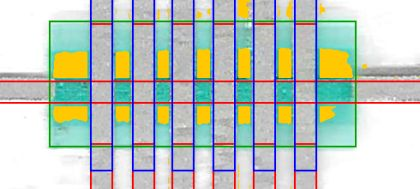

**[Doğrulama] Taramaya bindirme** — `overlay.png`  
Çizim geometrisi taramanın üstüne çizildi. Bindirme renkleri: kırmızı gümüş (alt baskı), mavi köprü (2. baskı), yeşil dielektrik, mor kesim/oval, turuncu taramada olup çizimde karşılığı olmayan gümüş.

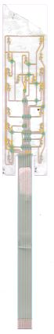

**[Çıktı kontrolü] Üretim PDF'i: tamamı** — `pdf_all.png`  
1:1 mm, 5 mm boşluk.

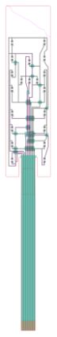

**[Çıktı kontrolü] Üretim PDF'i: baş üst** — `pdf_head.png`  
Gümüş, köprüler, yamalar, LED'ler; mor kesikli = Kontrol katmanı.

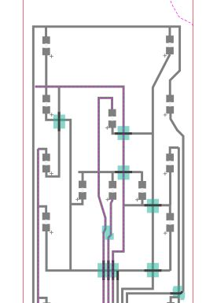

**[Çıktı kontrolü] Üretim PDF'i: bus bölgesi** — `pdf_bas_alt.png`  
Yama sıraları ve köprüler.

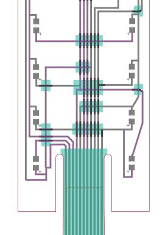

**[Çıktı kontrolü] Üretim PDF'i: konnektör ucu** — `pdf_tailend.png`  
11 kontak ve takviye.

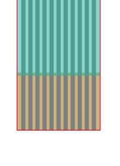

**[Çalışma görüntüleri] Segment bulucu (m_dark)** — `segs_vis.png`  
Yatay/dikey/45° segment adayları; koordinat tablosu için.

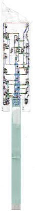

## Çıktılar

- `output/P3_duzenlenebilir.svg` — CorelDRAW'da düzenleme (hatlar kalınlıklı çizgi, pedler dikdörtgen)
- `output/P3_uretim.svg` — Üretim: her katman tek kapalı dolgu
- `output/P3_uretim.pdf` — Üretim: katmanlı vektör PDF
- `output/P3_kontrol_taramali.svg` — Kontrol: çizim + altta hizalı tarama