# P4 - Uzun tuş devresi (3 tuş, 11 pin 1.0 mm)

*13.11.2026 17:40 — fpc-vektor skill · etkileşimli sürüm: `P4_rapor.html`*

**Kabul:** GEÇTİ · **Belirsiz rota:** 0 · **Kontrol maddesi:** 5 · **Karar noktası:** 10

## Özet

3 tuşlu membran anahtar katmanı (tarak tipi pedler), 20 oval LED ışık penceresi, 11 pinlik 1.0 mm ZIF kuyruğu. Tek gümüş baskı + dielektrik şerit/çerçeve. P3 uzun LED devresiyle üst üste biner; tuş grubu ve kuyruk yerleşimi P2 ile aynıdır, baş 54 mm, kuyruk 46 mm daha uzundur.

## Analiz süreci

1. **Kaynağın incelenmesi** — K.pdf'teki 4. parça. Önizlemede 3 tarak ped, 20 oval pencere ve uzun kuyruk görüldü; tip = tuş. P3 (uzun LED) ile aynı setin tuş katmanı.
2. **Kırpım ve eğiklik** — Hough doğrularıyla genel eğiklik 1.07° bulundu. Ancak bölge bazında ölçüm farklı açılar verdi: baş 0.53–0.93°, kuyruk 0.97–1.17°. Tek açıyla döndürülünce baş hatları 1650 px boyunca 12 px kayıyordu (0.43°).
3. **Bükülme düzeltmesi** — Hat merkezleri her 50 px'te izlendi. Baş baskısı rijit ve kuyruğa göre 0.445° dönük; kuyruk ±4 px yay çiziyor. Eksenin yanal kayması dx(y) parçalı doğrusal profil olarak parts/p4.json 'bukulme' alanına yazıldı; prep.py her satırı bu kadar kaydırıp yerel eğimle döndürüyor (yatay kenarlar eksene dik kalıyor). Sonrasında 13 uzun hattın tamamı ≤ 2 px içinde düz (Kapı 2).
4. **Renk segmentasyonu** — P2 ile aynı tarif: gümüş = yerel arka plandan 22 birim koyu ve düşük doygunluk, dielektrik = G−R &gt; 30. Ped içleri düşük kontrastlı (film kalkık, gölge yoğun).
5. **Ölçek kontrolü** — Kuyruktaki 9 hattın merkezleri 5300 px boyunca izlendi; adım 47.31 px (47.17 px/mm ile 1.003 mm). Setin ortak kalibrasyonu 47.17 px/mm korundu; fark uç kontaklarda ±0.7 px.
6. **Kesim konturu** — Baş kenarları 13 y'de, üst/alt kenarlar 8–10 x'te ölçüldü. Baş 36.7 × 141.5 mm (P2 ile aynı genişlik). Kesim, baskıya göre ~0.22° dönük. Köşeler keskin (R 0.2–0.4). Yarıklar 2.0 mm, üst ucu 125.65 mm. Kuyruk baş altında 11.35 mm, y≈137–158 mm arasında 11.8 mm'ye genişliyor.
7. **Hatlar ve dielektrik şeritler** — Şerit içi gümüş maskesinden kaba rotalar çıkarıldı, refine_route ile oturtuldu. Dikeyler 0.02–0.09° içinde dikey; köşeler 45° pah, Net1 üst çapraz 60.07°, alt çaprazlar 67.1° / 64.8° / 64.3°. Net2 y≈79–88 mm arasında 0.2 mm sağa kayıyor. Hat 0.50 mm, şerit 2.0 mm.
8. **Dielektrik baskı kayması** — Dikey şeritlerde gümüşün sağında 1.2 mm, solunda 0.75 mm dielektrik var; yatay şeritlerde üstte 1.2, altta 0.8 mm. Ped çerçeveleri de aynı yöne kayık. Çizim dielektriği kaydırılarak IoU taraması yapıldı: en iyi kayma x +0.15, y −0.15 mm (baş IoU 0.951, tamamı 0.980).
9. **Tarak pedleri** — Ped kenarları gölge yüzünden yumuşak; alt kenarlar keskin olduğundan ped konumu alt kenardan 5.0 mm yukarı alındı ve üst bar başlangıcıyla doğrulandı. Parmak adımı 1.10 mm (B: 51.75 px, C: 52.75 px). A üst tarakta dış 3 parmak, B ve C'de iç 2 parmak (P2 ile aynı). Tuş ekseni x = 19.2 mm (kart ekseninden +0.85).
10. **Kuyruk bağlantı blokları ve konnektör** — Blok üstü 125.65, çentik 127.05 mm; bloklar 2-2-2-3 kontak (P2 ile aynı). Kuyruk dielektrik bloğu 13.0 mm genişlikte, 124.4 mm'de başlıyor. Uçta takviye 258.25, dummy kontaklar 258.35, dielektrik bitişi 259.05 mm (kayma düzeltilmiş).
11. **Oval pencereler** — 20 oval otomatik bulundu (L &gt; 244 bileşenleri) ve stadium fit yapıldı. Genişlik ortalaması 155 px = 3.29 mm, boy 289 px = 6.12 mm. Sütunlar x = 5.0 / 31.7 (P2 ile aynı); satır adımı 12.75 mm, 4. ile 5. satır arası 1.5 adım. Orta ovaller P2 ile aynı x'lerde (19.2 ± 6.45).
12. **Üretim ve doğrulama** — Parametrik tasarımdan 4 dosya üretildi ve taramaya bindirildi. Dielektrik IoU 0.979, kenar 0.021/0.085 mm; gümüş kenar 0.042/0.064 mm. KABUL: GEÇTİ.

## Bulgular

- Yapı: tek gümüş baskı + dielektrik (hat üstünde 2.0 mm şerit, ped çevresinde 0.2 mm çerçeve, kuyrukta tam kaplama) + arka takviye. P2 ile aynı tasarım ailesi.
- 4 elektriksel ağ: Net1 = A üst tarak (pin 1-2); Net2 = B alt tarak (3-4); Net3 = C alt tarak (5-6); Net4 (ortak) = A alt + B ve C üst tarakları (9-11). 7-8 dummy. Her pedin iki tarağı farklı ağda; kısa devre/kopukluk yok.
- Tuş grubu kart eksenine göre 0.85 mm sağda (x = 19.2 mm) — P2 ile birebir aynı.
- Film taramada düzlemde bükük: baş baskısı kuyruğa göre 0.445° dönük, kuyruk ±4 px (0.08 mm) yay. Bu bir tarama artefaktı (film camda düz yatmıyor), düzeltildi.
- Kesim deseni baskıya göre ~0.22° dönük (baş yan kenarları 6000 px'te 20 px kayıyor); ovaller ise baskıyla 0.1° içinde hizalı.
- Dielektrik baskısı gümüşe göre x +0.15…+0.24, y −0.09…−0.21 mm kayık (baskı registrasyonu). Bindirme her yanda ≥ 0.55 mm kaldığı için elektriksel risk yok.
- Kuyruk genişliği baş altında 11.35 mm, y≈158 mm'den sonra 11.8 mm. P2'de kuyruk 12.1 mm idi.
- Kuyruk hat adımı 47.31 px (1.003 mm) ve oval satır adımı 12.75 mm: P4 filmi P2'ye göre ~%0.3 büyük görünüyor (film genleşmesi veya tarayıcı yatağı farkı).
- Baş üst sağında çapraz kenarlı gri üçgen bölge ve pedler çevresinde daire/kanal biçimli izler var; baskı değil (spacer/yapışkan katmanı izi olabilir). P3'ün baş köşesindeki çapraz kesimle ilişkisi P3 analizinde kontrol edilecek.

## Karar noktaları

### K1. Kapsam

- Seçenek: P3
- Seçenek: P4
- Seçenek: P3 ve P4
- **Seçilen:** P3 ve P4 (kullanıcı isteği). Amaç, format ve katmanlar P2 pilotunda onaylandığı gibi: üretim + dokümantasyon, SVG + PDF, katmanlar kontur, gümüş, dielektrik, LED.
- Gerekçe: Önce tuş katmanı (P4) çizildi; P3'ün LED konumları P4 ovalleriyle çapraz kontrol edilecek.

### K2. Bükülmüş filmin düzeltilmesi

- Seçenek: Tek açı (1.07°), hataları kabul et
- Seçenek: Baş ve kuyruk için ayrı açı, birleşimde dikiş
- Seçenek: Satır bazlı bükülme düzeltmesi (eksen kayması profili)
- **Seçilen:** Satır bazlı bükülme düzeltmesi
- Gerekçe: Tek açıyla baş hatları 12 px (0.25 mm) kayıyordu; kenar eşiği 0.06 mm. Profil düzeltmesi sonrası 13 hattın tamamı ≤ 2 px düz. Dikişli çözüm birleşim bölgesinde süreksizlik yaratırdı.
- Risk: Yarıklar arasında (y 125–141 mm) baş ile kuyruk farklı eğimde; baş alt köşelerinde ≤ 3 px (0.06 mm) hata kalabilir.
- Kanıt: [bukulme.png](P4_rapor_gorseller/bukulme.jpg), [v_bukulme_once_sonra.png](P4_rapor_gorseller/v_bukulme_once_sonra.jpg)

### K3. Ölçek

- Seçenek: P4 kuyruk adımından 47.31 px/mm
- Seçenek: Setin ortak kalibrasyonu 47.17 px/mm
- **Seçilen:** Ortak kalibrasyon 47.17 px/mm
- Gerekçe: Aynı tarayıcı ve aynı sayfa; baş genişliği (36.7), oval sütun aralığı (26.7) ve ped aralığı (11.6) 47.17 ile P2 ile birebir çıkıyor. 47.31 ile bunlar 0.1 mm küçülürdü. Konnektör adımı tasarımda 1.00 mm.
- Risk: Kuyruk uç kontakları taramaya göre ±0.03 mm.
- Kanıt: [v_tailmid.png](P4_rapor_gorseller/v_tailmid.jpg)

### K4. Dielektrik baskı kayması

- Seçenek: Ölçüldüğü gibi (kaymalı) çiz
- Seçenek: İdeal (gümüşe merkezli) çiz, doğrulamada kaymayı telafi et
- **Seçilen:** İdeal çizim; doğrulama +0.15 / −0.15 mm telafili
- Gerekçe: Kayma bir baskı toleransı; üretim filmi merkezli olmalı. Telafili doğrulamada IoU 0.979. Telafisiz IoU 0.956, kenar %90 0.21 mm olurdu.
- Risk: Kayma tasarımdan geliyorsa (bilerek asimetrik şerit) çizim 0.2 mm farklı olur.
- Kanıt: [v_diel_kayma.png](P4_rapor_gorseller/v_diel_kayma.jpg), [v_padBC.png](P4_rapor_gorseller/v_padBC.jpg)

### K5. Kesim deseninin dönüklüğü

- Seçenek: Ölçüldüğü gibi (0.22° dönük)
- Seçenek: İdeal: baskıya hizalı ve simetrik
- **Seçilen:** İdeal hizalı ve simetrik
- Gerekçe: P2 ile aynı ilke: kesim–baskı dönüklüğü üretim toleransı. Ovaller baskıyla hizalı.
- Kanıt: [v_top_diag.png](P4_rapor_gorseller/v_top_diag.jpg), [corners.png](P4_rapor_gorseller/corners.jpg)

### K6. Kuyruk genişliğinin değişmesi

- Seçenek: Sabit 11.8 mm
- Seçenek: Ölçüldüğü gibi: 11.35 → 11.8 mm genişleme
- **Seçilen:** Ölçüldüğü gibi genişleme
- Gerekçe: Genişlik 60 noktada ölçüldü; fark 0.45 mm ve hatların adımı değişmiyor (izdüşüm etkisi değil). Sabit genişlik baş altında 0.22 mm sapma verirdi.
- Risk: Kesim kalıbı aslında düzse fark tarama sırasında kuyruğun eğilmesinden olabilir; kumpasla ölçülmeli.
- Kanıt: [kuyruk_genislik.png](P4_rapor_gorseller/kuyruk_genislik.jpg)

### K7. Oval boyutları ve satır adımı

- Seçenek: P2 değerleri (3.2 × 6.1, adım 12.7)
- Seçenek: Ölçülen (3.3 × 6.1, adım 12.75)
- **Seçilen:** Ölçülen 3.3 × 6.1, adım 12.75
- Gerekçe: 20 ovalin genişlik ortalaması 3.29 mm; satır fit artığı 12.75 ile ≤ 0.17 mm, 12.7 ile 0.3 mm'ye çıkıyor.
- Kanıt: [v_head1.png](P4_rapor_gorseller/v_head1.jpg), [v_head2.png](P4_rapor_gorseller/v_head2.jpg)

### K8. Net2'deki küçük kayma

- Seçenek: Düz hat (x = 15.7)
- Seçenek: Ölçüldüğü gibi: y 79.45 → 87.9 arasında 15.6 → 15.8
- **Seçilen:** Ölçüldüğü gibi
- Gerekçe: Hat 40 noktada izlendi; üstte 910.4 px, altta 919.6 px, geçiş 400 px'lik bölgede. Düz hat ±0.1 mm sapma verirdi.
- Kanıt: [v_net2jog.png](P4_rapor_gorseller/v_net2jog.jpg), [kontrol_capraz_bolge.png](P4_rapor_gorseller/kontrol_capraz_bolge.jpg)

### K9. Köşe yarıçapı

- Seçenek: R1.0 (P2 varsayımı)
- Seçenek: Ölçülen R0.3
- **Seçilen:** R0.3 (fiziksel kontrol maddesi)
- Kanıt: [corners.png](P4_rapor_gorseller/corners.jpg)

### K10. Üst sağdaki gri üçgen ve daire izleri

- Seçenek: Çiz (ayrı katman)
- Seçenek: Çizme, rapora yaz
- **Seçilen:** Çizilmedi, kontrol listesinde
- Gerekçe: Gümüş/dielektrik rengi değil, dokusuz; spacer/yapışkan izi olabilir.
- Kanıt: [v_top_diag.png](P4_rapor_gorseller/v_top_diag.jpg), [v_padA.png](P4_rapor_gorseller/v_padA.jpg)

## Ölçüler

| Ölçü | Değer | Not |
|---|---|---|
| Baş (genişlik × yükseklik) | 36.7 × 141.5 mm | köşe R0.3 |
| Toplam boy | 266.25 mm |  |
| Kuyruk genişliği | 11.35 → 11.8 mm | y=137.5–157.5 arasında genişler |
| Yarık | 2.0 mm | üst ucu y=125.65 |
| Konnektör | 11 poz × 1.0 mm | kontak 0.6 mm, 7-8 dummy |
| Hat genişliği (baş) | 0.5 mm | dielektrik şerit 2.0 mm |
| Tuş pedi | 5.0 × 5.0 mm | bar 0.55, parmak 0.6, boşluk 0.5, uç boşluğu 0.5 mm |
| Oval pencere | 3.3 × 6.1 mm | 20 adet, satır adımı 12.75 mm |
| Dielektrik bitişi / takviye | y=259.05 / y=258.25 mm |  |
| Dielektrik baskı kayması (ölçülen) | x +0.15 / y -0.15 mm | çizimde ideal |
| Kart sınır kutusu | 36.70 × 266.25 mm | Kesim konturu |
| Kart alanı | 6599.8 mm² |  |
| Gümüş alanı (alt baskı) | 983.7 mm² |  |
| Dielektrik alanı | 2231.5 mm² |  |

| Eleman | Adet |
|---|---|
| Hat (polyline) | 16 |
| Gümüş dikdörtgen (ped/blok/parmak) | 25 |
| Oval pencere | 20 |
| LED | 0 |
| Dielektrik yama | 0 |
| Köprü | 0 |
| Kontrol (belirsiz) rota | 0 |

### Varsayımlar

- Ölçek setin ortak kalibrasyonu 47.17 px/mm (P1/P2 konnektör adımı 1.00 mm); P4 kuyruğunda adım 1.003 mm ölçüldü.
- Film taramada düzlemde bükük: baş baskısı kuyruğa göre 0.445° dönük, kuyruk ±4 px yay. Ön işlemede satır bazlı bükülme düzeltmesi uygulandı (parts/p4.json 'bukulme').
- Kesim deseni baskıya göre ~0.22° dönük ölçüldü; çizimde ideal hizalı ve simetrik alındı.
- Dielektrik baskısı gümüşe göre ~0.2 mm sağa, ~0.15 mm yukarı kayık; çizimde gümüşe merkezli alındı.
- Baş köşe yarıçapı R0.3 mm (taramada 0.2–0.4 mm).
- Tüm ovaller 3.3 × 6.1 mm (ölçülen genişlik 3.16–3.40, boy 5.8–6.4 mm).
- Ped çevresindeki ince turkuaz çerçeve dielektrik baskı kabul edildi.
- Yatay gümüş kenarların ~0.4 mm üstündeki koyu bantlar tarayıcı gölgesi sayıldı, çizilmedi.

## Doğrulama

| Metrik | Değer | Eşik | Sonuç |
|---|---|---|---|
| Gümüş kenar sapması medyan | 0.015 mm | ≤ 0.06 mm | ✔ |
| Gümüş kenar sapması %90 | 0.042 mm | ≤ 0.15 mm | ✔ |
| Gümüş kenar kapsaması | 0.962 | ≥ 0.8 | ✔ |
| Dielektrik IoU | 0.979 | ≥ 0.95 | ✔ |
| Dielektrik kenar sapması medyan | 0.022 mm | ≤ 0.06 mm | ✔ |
| Dielektrik kenar sapması %90 | 0.081 mm | ≤ 0.15 mm | ✔ |
| Ağ / tutarlılık HATA (bilinmeyen) | 0 | ≤ 0 | ✔ |
| Gümüş sistematik ofset (her yan) / kayma | -0.009 mm / (-0.004, +0.021) mm | |ofset| uyarı > 0.03 | — |
| Gümüş işaretli sapma medyanı | -0.011 mm | + geniş / − dar | — |
| Gümüş yoğunluk kenarı (maskeden bağımsız) medyan / %90 | 0.014 / 0.038 mm | kapsama 0.99; ±6 px dışı sapma ölçülmez (kapı değil) | — |
| Gümüş yoğunluk ofseti / kayma / bulanıklık σ | -0.008 mm / (-0.004, +0.024) mm / 0.036 mm | maske ofsetiyle farkı = maske yanlılığı | — |
| Gümüş: tarama kenarlarının çizime ≤ 3 px oranı | 0.579 | bilgi (ters yön) | — |
| Gümüş IoU | 0.744 | bilgi | — |
| Taramada karşılıksız gümüş (ham / gölge hariç) | 0.185 / 0.173 | uyarı > 0.15 | — |
| Dielektrik sistematik ofset (her yan) / kayma | -0.020 mm / (-0.017, -0.018) mm | |ofset| uyarı > 0.03 | — |
| Dielektrik işaretli sapma medyanı | -0.014 mm | + geniş / − dar | — |
| Dielektrik yoğunluk kenarı (maskeden bağımsız) medyan / %90 | 0.030 / 0.090 mm | kapsama 0.99; ±6 px dışı sapma ölçülmez (kapı değil) | — |
| Dielektrik yoğunluk ofseti / kayma / bulanıklık σ | -0.011 mm / (-0.022, -0.037) mm / 0.042 mm | maske ofsetiyle farkı = maske yanlılığı | — |
| Dielektrik: tarama kenarlarının çizime ≤ 3 px oranı | 0.841 | bilgi (ters yön) | — |
| Dielektrik IoU | 0.979 | kapıda | — |
| Gölge ofseti δ (genel) / kalkık karo | 0.36 mm / 7 | golge_haritasi.png | — |
| Gümüş kenar (eski tam-piksel yöntem) medyan / %90 | 0.021 / 0.042 mm | önceki sürümle kıyas | — |
| Dielektrik kenar (eski tam-piksel yöntem) medyan / %90 | 0.021 / 0.085 mm | önceki sürümle kıyas | — |

### En büyük sapmalı elemanlar

| Eleman | Tür | Medyan mm | Ofset mm | Kayma mm | Kapsama | Örnek |
|---|---|---|---|---|---|---|
| Blok_Net4 | dikdortgen | 0.155 | +0.000 | (+0.000, +0.000) | 0.03 | 77 |
| Blok_Net1 | dikdortgen | 0.067 | +0.028 | (-0.049, +0.000) | 0.17 | 58 |
| Ped_A | tus_ped | 0.058 | +0.048 | (-0.002, -0.057) | 0.33 | 845 |
| Ped_B | tus_ped | 0.049 | +0.050 | (+0.013, -0.062) | 0.48 | 857 |
| Blok_Net3 | dikdortgen | 0.040 | +0.000 | (+0.000, +0.000) | 0.05 | 58 |
| Blok_Net2 | dikdortgen | 0.017 | +0.000 | (+0.000, +0.000) | 0.05 | 58 |
| Ped_C | tus_ped | 0.046 | -0.025 | (+0.024, +0.029) | 0.53 | 776 |
| Kontak_01 | kontak | 0.025 | -0.040 | (+0.027, +0.000) | 1.00 | 4107 |
| Kontak_02 | kontak | 0.022 | -0.022 | (-0.002, +0.000) | 1.00 | 4108 |
| Hat_Net4_Ortak | hat | 0.021 | -0.005 | (-0.002, +0.043) | 0.98 | 2833 |
| Hat_Net2_B_alt | hat | 0.021 | -0.007 | (-0.006, +0.155) | 0.96 | 2104 |
| Kontak_03 | kontak | 0.018 | -0.016 | (+0.006, +0.000) | 1.00 | 4107 |

## Ağ ve tasarım tutarlılığı

HATA 0 · UYARI 1 · bilgi 14 · kabul edilmiş 0

| Seviye | Kontrol | Açıklama | Konum (mm) | Kimlik |
|---|---|---|---|---|
| UYARI | Taramada çizilmemiş gümüş | Taramadaki gümüşün %17'i (gölge hariç) çizimde karşılıksız (turuncu kümeleri inceleyin) | — | `karsiliksiz_gumus:gumus` |

### Çizimden çıkarılan ağlar

| Ağ | Pinler | Uçlar | Hat |
|---|---|---|---|
| 1 | 1, 2 | Ped_A.ust | 3 |
| 2 | 3, 4 | Ped_B.alt | 3 |
| 3 | 5, 6 | Ped_C.alt | 3 |
| 4 | 9, 10, 11 | Ped_A.alt, Ped_B.ust, Ped_C.ust | 6 |
| 5 | dummy 7 | — | 0 |
| 6 | dummy 8 | — | 0 |

## Önerilen düzeltmeler (ölçümden)

- **diel_kayma:** Dielektrik, telafiden sonra hâlâ (-0.022, -0.037) mm kayık: SCAN['diel_kayma_mm'] [0.15, -0.15] -> [0.172, -0.113] (çizim ideal kalır, yalnız doğrulama telafisi).
- **hizalama:** Gümüş çizimi genel olarak (-0.004, +0.024) mm kaymış. mm ile tanımlı (parametrik) elemanlar için SCAN px0 1040.0 -> 1040.2, py0 183.0 -> 181.8. Taramadan px ile okunan rotalar bu değişiklikten etkilenmez.
- **eleman:** 'Hat_Net2_B_alt' (hat) taramaya göre (-0.008, +0.101) mm kaymış -> (+0.008, -0.101) mm taşı
- **eleman:** 'Ped_A' (tus_ped) taramaya göre (+0.002, +0.048) mm kaymış -> (-0.002, -0.048) mm taşı
- **eleman:** 'Hat_Net4_Ortak' (hat) taramaya göre (-0.005, +0.045) mm kaymış -> (+0.005, -0.045) mm taşı
- **eleman:** 'Ped_B' (tus_ped) taramaya göre (+0.007, +0.041) mm kaymış -> (-0.007, -0.041) mm taşı

## Pin eşlemesi

| Pin | Bağlantı |
|---|---|
| 1-2 | Net1: A üst tarak (sol dış hat) |
| 3-4 | Net2: B alt tarak |
| 5-6 | Net3: C alt tarak |
| 7-8 | dummy |
| 9-11 | Net4 ortak: A alt + B/C üst tarak |

## Fiziksel kontrol

- [ ] Kuyruk genişliği: baş altında ~11.35 mm, y≈163 mm'den sonra ~11.8 mm ölçüldü (kumpasla iki noktada ölçün).
- [ ] Köşe yarıçapı (R0.3 mm varsayıldı)
- [ ] Ped çerçevesi: dielektrik mi, spacer/yapışkan kenarı mı?
- [ ] Kuyruk ucundaki ~8 mm bölge arka yüz takviyesi mi?
- [ ] Baş üst sağındaki üçgen gri bölge ve pedler çevresindeki daire/kanal izleri: ayrı katman (spacer/yapışkan) mı?

## Daha iyi sonuç için

- **Kumpasla 4 ölçü verin:** Baş genişliği, toplam boy, kuyruk genişliği (baş altında ve ortada) ve bir ovalin genişliği. Kuyruk daralması ve %0.3'lük ölçek farkını kesinleştirir.
- **Dielektrik kaymasını doğrulayın:** Gümüş hatların bir yanında dielektrik 1.2 mm, diğer yanında 0.75 mm mi? Tüm numunelerde aynıysa tasarım kasıtlı olabilir; söylerseniz DIEL_KAYMA çizime de uygulanır.
- **Daha iyi tarama için:** Uzun parçalar camda bükülüyor ve kalkıyor: filmi cam veya düz karton ile bastırın, mümkünse arkadan aydınlatın. Bükülme düzeltmesine ve gölge yorumuna gerek kalmaz; ped parmakları da net okunur.
- **Ek katmanı bildirin:** Baş üst sağdaki gri üçgen ve pedler çevresindeki daire izleri ayrı bir spacer/yapışkan katmansa, onun çizimi de istenebilir.
- **CorelDRAW geri bildirimi:** Katmanların grup olarak gelip gelmediğini ve renk/saydamlıkları bildirin.

## Analiz görselleri

**[Kaynak] Taramanın genel görünümü** — `_tarama/genel.png`  
K.pdf ~60 dpi önizleme. 4 = P4 (uzun tuş).

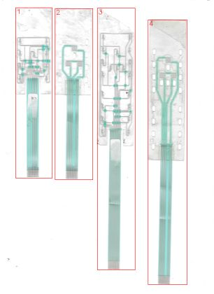

**[Kaynak] P4 önizleme** — `_tarama/parca_4.png`  
~150 dpi: baş bölgesinde 3 tarak ped ve 20 oval pencere, altta uzun kuyruk.

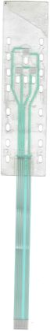

**[Kaynak] Kaynak görüntü** — `_tarama/parca_1.png`  
Taramadan kırpılan / incelenen ham görüntü.

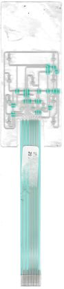

**[Kaynak] Kaynak görüntü** — `_tarama/parca_2.png`  
Taramadan kırpılan / incelenen ham görüntü.

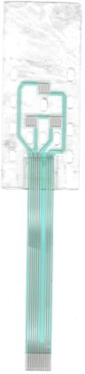

**[Kaynak] Kaynak görüntü** — `_tarama/parca_3.png`  
Taramadan kırpılan / incelenen ham görüntü.

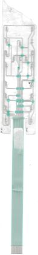

**[Ön işleme] Eğiklik ve bükülme düzeltilmiş görüntü** — `p4_deskew.png`  
1.07° döndürme + satır bazlı bükülme düzeltmesi. Tüm ölçümler bu görüntünün piksel koordinatlarında. *Ölçüm: 13 uzun hat ≤ 2 px düz*

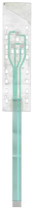

**[Ön işleme] Bükülme düzeltme profili** — `bukulme.png`  
Eksenin yanal kayması dx(y). Sol doğrusal kısım başın 0.445° dönüklüğü; sağda kuyruğun ±4 px yayı (kırmızı noktalar 9 hat ortalaması).

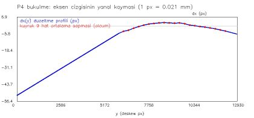

**[Maskeler] Hızlı segmentasyon** — `seg_hizli.png`  
Gri ve turkuaz için basit renk eşikleri.

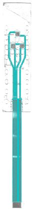

**[Maskeler] Gümüş + dielektrik maskesi** — `seg3.png`  
Yerel arka plana göre gümüş ve G−R &gt; 30 dielektrik; topoloji buradan okundu.

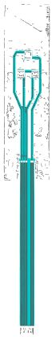

**[Maskeler] Gölge ofseti (film kalkıklığı) haritası** — `golge_haritasi.png`  
Film camdan kalkık olduğunda her gümüş şeklin koyu kopyası δ kadar yukarı düşer. Karolardaki sayı yerel δ (mm), renk mavi (küçük) → kırmızı (büyük); büyük δ = film daha kalkık, kenarlar daha bulanık. Mor = gölge olarak açıklanan pikseller (doğrulamada karşılıksız gümüş ve kenar örneklerinden çıkarılır).

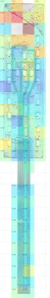

**[Ölçüm] Kuyruk hatları yakın çekim** — `v_tailmid.png`  
9 hat + 7-8 pozisyonlarında boşluk. Hat 0.6, aralık 0.4 mm. *Ölçüm: adım 47.31 px*

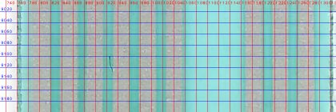

**[Ölçüm] Baş üst bölgesi** — `v_top_diag.png`  
Üst kenar (gölge bandının alt ucu ~183 px), ilk sıra ovaller ve üst sağda çapraz kenarlı gri üçgen bölge (baskı değil).

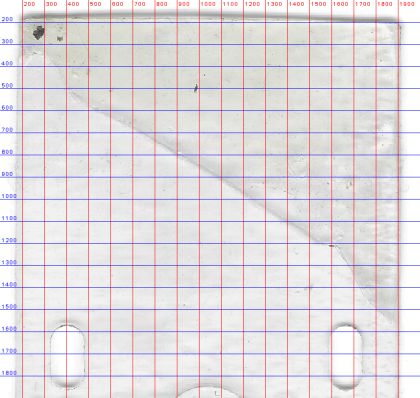

**[Ölçüm] Baş köşeleri** — `corners.png`  
Sol üst, sağ üst, sol alt, sağ alt; 20 px ızgara. Yarıçap 0.2–0.4 mm.

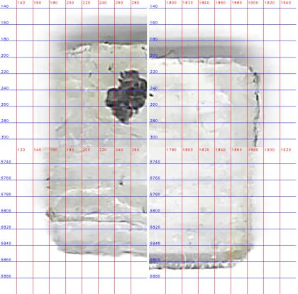

**[Ölçüm] Baş–kuyruk birleşimi** — `v_jn.png`  
Yarıklar (2.0 mm, üst ucu 125.65 mm), baş alt kenarı 141.5 mm ve kuyruğun başlangıcı.

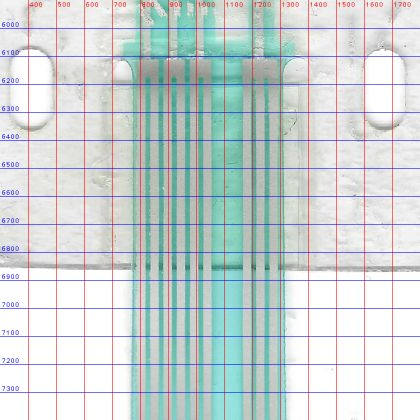

**[Ölçüm] Ped A** — `v_padA.png`  
Düşük kontrast; üst barın üstündeki koyu bant gölge. Ped çevresindeki büyük açık daire spacer izi. *Ölçüm: alt kenar 2215 px, ped 5.0 × 5.0 mm*

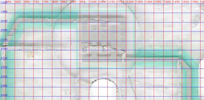

**[Ölçüm] Ped B ve C** — `v_padBC.png`  
5'er parmak (adım 1.1 mm), üst barlar bus ile birleşik. Çerçeveler sağa kayık (K4). *Ölçüm: B merkez 804.5 px, C 1353.5 px, aralık 11.64 mm*

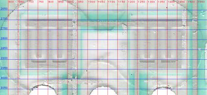

**[Ölçüm] Kuyruk bağlantı blokları** — `v_j1.png`  
4 hat 2-2-2-3 kontaklık bloklara giriyor; çentik altında hatlar ayrılıyor. *Ölçüm: blok 125.65, çentik 127.05 mm*

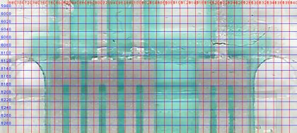

**[Ölçüm] Konnektör ucu yakın çekim** — `v_ct.png`  
Dielektrik bitişi, takviye kenarı (koyu + parlak çizgi) ve dummy kontakların başlangıcı. *Ölçüm: takviye 258.25, dielektrik 259.05 mm*

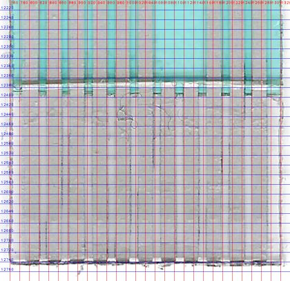

**[Ölçüm] Kuyruk ucu** — `v_end.png`  
11 kontak, uç 266.25 mm.

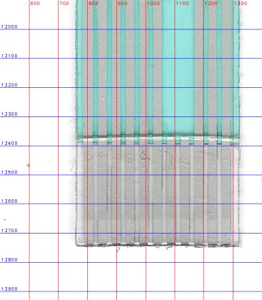

**[Topoloji] Baş bölgesi üst yarı (ızgaralı)** — `v_head1.png`  
Pedler, hatlar, ovaller. Izgara 200 px (~4.24 mm).

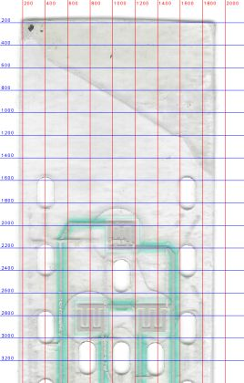

**[Topoloji] Baş bölgesi alt yarı (ızgaralı)** — `v_head2.png`  
Çaprazlar, kuyruğa inen 4 hat, alt ovaller ve yarıklar.

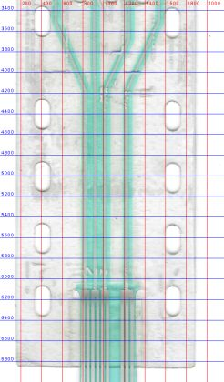

**[Topoloji] B/C bus'ının sağ hatta bağlantısı** — `v_busR.png`  
Bus (y≈2721 px) C üst barından sağ dış hatta (Net4) bağlanıyor. Beyaz noktalı dikey çizgi spacer izi.

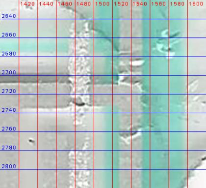

**[Topoloji] Çizimden çıkarılan ağ haritası** — `ag_haritasi.png`  
Çizim geometrisinden çıkarılan elektrik ağları: her ağ ayrı renk, köprüler koyu kontur, altta pin numaraları; kırmızı halka = HATA, turuncu = UYARI, gri = bilinen (kabul edilmiş) bulgu.

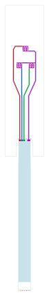

**[Karar kanıtı] Bükülme düzeltmesi öncesi / sonrası** — `v_bukulme_once_sonra.png`  
Baş alt bölgesindeki üç hat (y 4250–6100 px) ve üst uçlarındaki dikey kılavuz çizgileri. Önce hatlar kılavuzdan 12 px sapıyor, sonra üst üste.

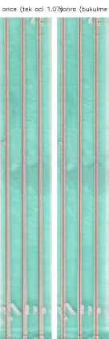

**[Karar kanıtı] Kuyruk genişliği boyunca** — `kuyruk_genislik.png`  
Film kenarı koyu çizgileri arası mesafe, 100 px adım. Mavi çizgi çizimdeki kontur. *Ölçüm: 11.35 → 11.8 mm*

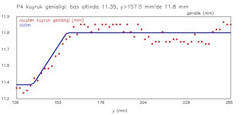

**[Karar kanıtı] Net2 kayma bölgesi** — `v_net2jog.png`  
Orta hat y≈3930–4330 px arasında 9 px sağa kayıyor; çaprazlar burada birleşiyor.

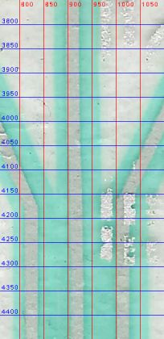

**[Karar kanıtı] Dielektrik baskı kayması** — `v_diel_kayma.png`  
Sol dış hat (Net1) kesiti, 5× büyütme. Kırmızı: gümüş merkezi, yeşil: şerit kenarları. Şerit merkezi gümüşün 11 px (0.24 mm) sağında.

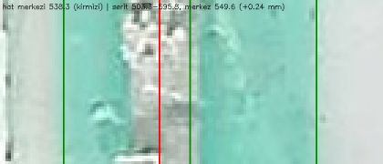

**[Doğrulama] Rapor kontrol kırpımı: bas bolgesi** — `kontrol_bas_bolgesi.png`  
Doğrulama bindirmesinden kırpım. Bindirme renkleri: kırmızı gümüş (alt baskı), mavi köprü (2. baskı), yeşil dielektrik, mor kesim/oval, turuncu taramada olup çizimde karşılığı olmayan gümüş.

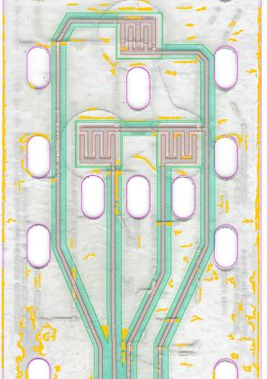

**[Doğrulama] Rapor kontrol kırpımı: capraz bolge** — `kontrol_capraz_bolge.png`  
Doğrulama bindirmesinden kırpım. Bindirme renkleri: kırmızı gümüş (alt baskı), mavi köprü (2. baskı), yeşil dielektrik, mor kesim/oval, turuncu taramada olup çizimde karşılığı olmayan gümüş.

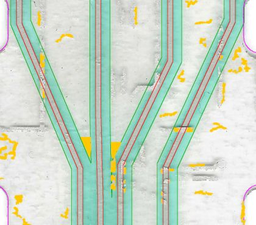

**[Doğrulama] Rapor kontrol kırpımı: konnektor ucu** — `kontrol_konnektor_ucu.png`  
Doğrulama bindirmesinden kırpım. Bindirme renkleri: kırmızı gümüş (alt baskı), mavi köprü (2. baskı), yeşil dielektrik, mor kesim/oval, turuncu taramada olup çizimde karşılığı olmayan gümüş.

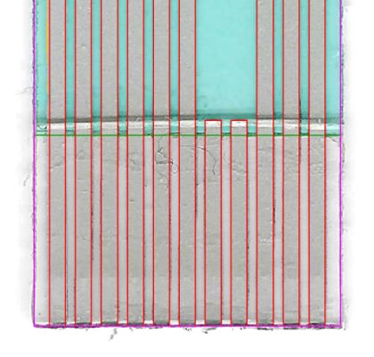

**[Doğrulama] Rapor kontrol kırpımı: kuyruk baglantisi** — `kontrol_kuyruk_baglantisi.png`  
Doğrulama bindirmesinden kırpım. Bindirme renkleri: kırmızı gümüş (alt baskı), mavi köprü (2. baskı), yeşil dielektrik, mor kesim/oval, turuncu taramada olup çizimde karşılığı olmayan gümüş.

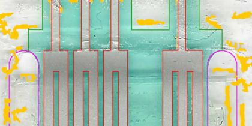

**[Doğrulama] Rapor kontrol kırpımı: kuyruk genisleme** — `kontrol_kuyruk_genisleme.png`  
Doğrulama bindirmesinden kırpım. Bindirme renkleri: kırmızı gümüş (alt baskı), mavi köprü (2. baskı), yeşil dielektrik, mor kesim/oval, turuncu taramada olup çizimde karşılığı olmayan gümüş.

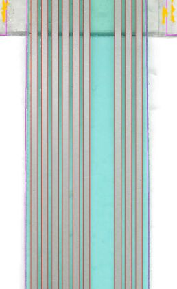

**[Doğrulama] Rapor kontrol kırpımı: ped a** — `kontrol_ped_A.png`  
Doğrulama bindirmesinden kırpım. Bindirme renkleri: kırmızı gümüş (alt baskı), mavi köprü (2. baskı), yeşil dielektrik, mor kesim/oval, turuncu taramada olup çizimde karşılığı olmayan gümüş.

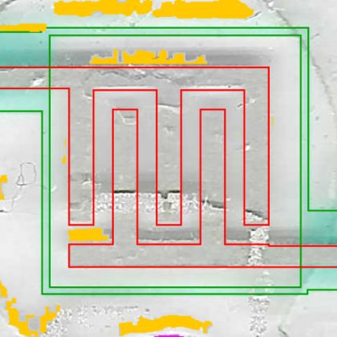

**[Doğrulama] Rapor kontrol kırpımı: pedler bc** — `kontrol_pedler_BC.png`  
Doğrulama bindirmesinden kırpım. Bindirme renkleri: kırmızı gümüş (alt baskı), mavi köprü (2. baskı), yeşil dielektrik, mor kesim/oval, turuncu taramada olup çizimde karşılığı olmayan gümüş.

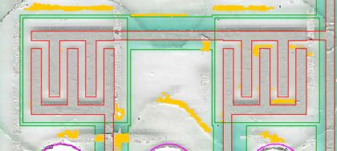

**[Doğrulama] Kenar sapması ısı haritası: bas bolgesi** — `kontrol_sapma_bas_bolgesi.png`  
Çizimin her kenar örneğinde taramadaki malzeme kenarına alt-piksel uzaklık: yeşil ≤ 0.02 mm, sarı ≤ 0.05, turuncu ≤ 0.10, kırmızı > 0.10 mm, mor taramada karşılık bulunamadı (eleman yanlış yerde ya da referans maske orada eksik).

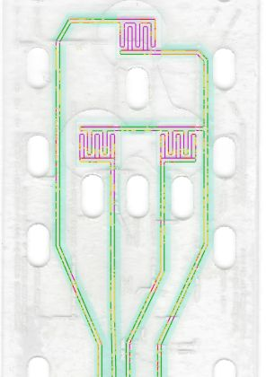

**[Doğrulama] Kenar sapması ısı haritası: capraz bolge** — `kontrol_sapma_capraz_bolge.png`  
Çizimin her kenar örneğinde taramadaki malzeme kenarına alt-piksel uzaklık: yeşil ≤ 0.02 mm, sarı ≤ 0.05, turuncu ≤ 0.10, kırmızı > 0.10 mm, mor taramada karşılık bulunamadı (eleman yanlış yerde ya da referans maske orada eksik).

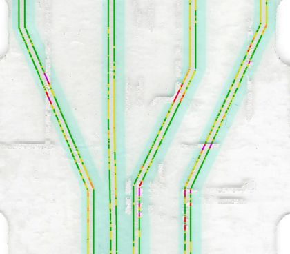

**[Doğrulama] Kenar sapması ısı haritası: konnektor ucu** — `kontrol_sapma_konnektor_ucu.png`  
Çizimin her kenar örneğinde taramadaki malzeme kenarına alt-piksel uzaklık: yeşil ≤ 0.02 mm, sarı ≤ 0.05, turuncu ≤ 0.10, kırmızı > 0.10 mm, mor taramada karşılık bulunamadı (eleman yanlış yerde ya da referans maske orada eksik).

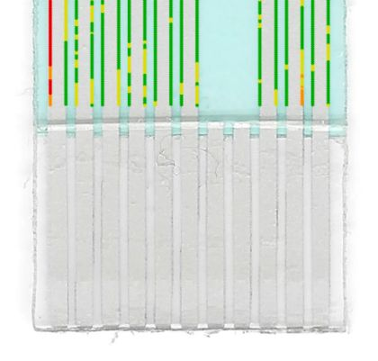

**[Doğrulama] Kenar sapması ısı haritası: kuyruk baglantisi** — `kontrol_sapma_kuyruk_baglantisi.png`  
Çizimin her kenar örneğinde taramadaki malzeme kenarına alt-piksel uzaklık: yeşil ≤ 0.02 mm, sarı ≤ 0.05, turuncu ≤ 0.10, kırmızı > 0.10 mm, mor taramada karşılık bulunamadı (eleman yanlış yerde ya da referans maske orada eksik).

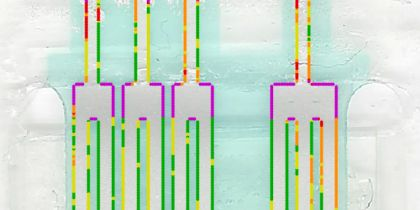

**[Doğrulama] Kenar sapması ısı haritası: kuyruk genisleme** — `kontrol_sapma_kuyruk_genisleme.png`  
Çizimin her kenar örneğinde taramadaki malzeme kenarına alt-piksel uzaklık: yeşil ≤ 0.02 mm, sarı ≤ 0.05, turuncu ≤ 0.10, kırmızı > 0.10 mm, mor taramada karşılık bulunamadı (eleman yanlış yerde ya da referans maske orada eksik).

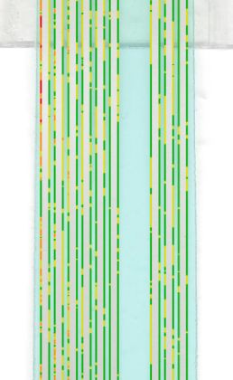

**[Doğrulama] Kenar sapması ısı haritası: ped a** — `kontrol_sapma_ped_A.png`  
Çizimin her kenar örneğinde taramadaki malzeme kenarına alt-piksel uzaklık: yeşil ≤ 0.02 mm, sarı ≤ 0.05, turuncu ≤ 0.10, kırmızı > 0.10 mm, mor taramada karşılık bulunamadı (eleman yanlış yerde ya da referans maske orada eksik).

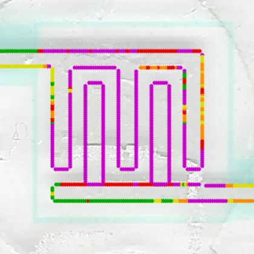

**[Doğrulama] Kenar sapması ısı haritası: pedler bc** — `kontrol_sapma_pedler_BC.png`  
Çizimin her kenar örneğinde taramadaki malzeme kenarına alt-piksel uzaklık: yeşil ≤ 0.02 mm, sarı ≤ 0.05, turuncu ≤ 0.10, kırmızı > 0.10 mm, mor taramada karşılık bulunamadı (eleman yanlış yerde ya da referans maske orada eksik).

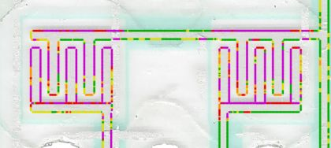

**[Doğrulama] Kenar sapması ısı haritası: tamamı** — `ov_sapma.png`  
Çizimin her kenar örneğinde taramadaki malzeme kenarına alt-piksel uzaklık: yeşil ≤ 0.02 mm, sarı ≤ 0.05, turuncu ≤ 0.10, kırmızı > 0.10 mm, mor taramada karşılık bulunamadı (eleman yanlış yerde ya da referans maske orada eksik).

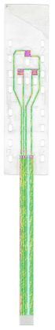

**[Doğrulama] Taramaya bindirme** — `overlay.png`  
Çizim geometrisi taramanın üstüne çizildi. Bindirme renkleri: kırmızı gümüş (alt baskı), mavi köprü (2. baskı), yeşil dielektrik, mor kesim/oval, turuncu taramada olup çizimde karşılığı olmayan gümüş.

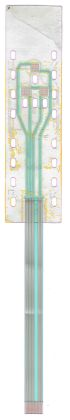

**[Çıktı kontrolü] Üretim PDF'i: tamamı** — `pdf_all.png`  
1:1 mm sayfa, her yanda 5 mm boşluk.

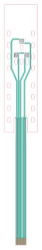

**[Çıktı kontrolü] Üretim PDF'i: tuş bölgesi** — `pdf_head.png`  
Pedler, hatlar, şeritler, çerçeveler ve ovaller.

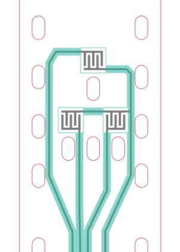

**[Çıktı kontrolü] Üretim PDF'i: kuyruk bağlantısı** — `pdf_kuyruk_baglantisi.png`  
Bloklar, yarıklar ve kuyruğun genişlemeye başladığı yer.

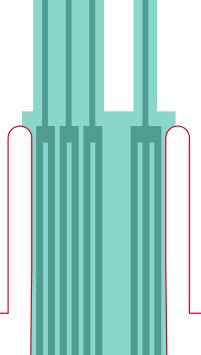

**[Çıktı kontrolü] Üretim PDF'i: konnektör ucu** — `pdf_tailend.png`  
Kontaklar, dummy kontaklar, takviye.

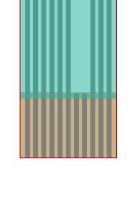

## Çıktılar

- `output/P4_duzenlenebilir.svg` — CorelDRAW'da düzenleme (hatlar kalınlıklı çizgi, pedler dikdörtgen)
- `output/P4_uretim.svg` — Üretim: her katman tek kapalı dolgu
- `output/P4_uretim.pdf` — Üretim: katmanlı vektör PDF
- `output/P4_kontrol_taramali.svg` — Kontrol: çizim + altta hizalı tarama